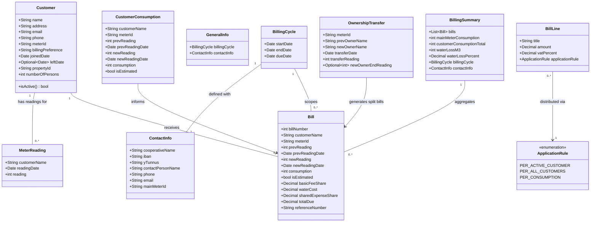

# Water Utility Billing CLI Tool

## Requirements

Implement a Finnish-language command-line tool that automates the complete billing workflow for a small water utility cooperative (~20 customers): ingest meter readings and configuration CSVs, compute per-customer water consumption and bill amounts, generate Finnish-standard bill PDFs with barcodes and virtual barcodes, email bills to customers, and produce a merged paper-bill PDF and treasurer billing summary. All user-facing text (CLI option names, help strings, CSV column headers, PDF content, email subject/body) must be in Finnish; source code identifiers in English. Data lives in CSV files on a local filesystem mounted from Google Drive.

## Entities



## Approach

1. CLI Architecture:
   - Use `typer` for Finnish-language CLI with three subcommands: `lasku` (generate bills CSV), `pdf` (generate bill PDFs), `julkaise` (publish — paper PDF + customer emails + yhteenveto PDF to treasurer)
   - Each subcommand accepts `--vuosi` (year) and `--data-hakemisto` (data root path) to locate input files
   - `julkaise` additionally requires SMTP credentials from `.env`; fail early with Finnish error if missing
   - Load `.env` via `python-dotenv` at startup

2. File Discovery:
   - Year folders under configurable data root; output files written to the cycle end year's folder
   - For each input type (`osakkaat`, `laskurivit`, `yleiset`, `lukemat`): glob `*-{type}-*.csv` in year folder, parse `YYYYMMDD` date prefix, filter to dates ≤ cycle date, sort descending, use first match
   - `lukemat` for current cycle is required; `laskut` from previous cycle (or seed) is required as ledger
   - Search previous year folder if current year yields no `laskut` result

3. Consumption Computation:
   - For each active customer: look up name in current `lukemat`; if found compute `new_reading − prev_reading` (prev from latest `laskut`); if absent copy previous consumption and flag `is_estimated = True`
   - Main meter consumption: current `päämittari` reading (from current `lukemat`) − previous `päämittari` reading (from most recent previous `lukemat` file)

4. Bill Line Distribution:
   - `PER_ACTIVE_CUSTOMER`: `ceil(amount / num_active_customers)` per cent per active customer
   - `PER_ALL_CUSTOMERS`: `ceil(amount / num_all_customers)` per cent per customer
   - `PER_CONSUMPTION`: `round(unit_price × consumption, 2)` per active customer (standard rounding)
   - Ceiling uses `decimal.ROUND_CEILING` after scaling by 100

5. PDF Generation:
   - `reportlab` for Finnish bill layout (A4); barcode via `python-barcode`; virtual barcode as printed text string
   - `pypdf` for merging individual bill PDFs into `paperilaskut`
   - `yhteenveto` PDF uses same `reportlab` infrastructure with different two-table layout

6. Email Delivery:
   - `smtplib` with STARTTLS or SSL configurable via `.env`; plain-text body contains total, due date, IBAN, virtual barcode, reference number
   - Iterate email-preference customers; catch per-customer SMTP exceptions, log, continue
   - Send `yhteenveto` to treasurer after all customer emails attempted
   - Report succeeded/failed counts on completion

7. Reference Number (Viitenumero):
   - Isolated pure-function module; weights `[7, 3, 1]` cycling from right; check digit = `(10 − sum % 10) % 10`; append to base number
   - Unit-tested against known Finnish banking examples before first production use

8. Virtual Barcode (Virtuaaliviivakoodi v5):
   - Isolated pure-function module; format validated against Finanssiala specification test vectors
   - Structure: version `5` + IBAN account digits + amount (8 digits, cents) + reserved `000` + reference (23 digits, left-zero-padded) + due date (YYMMDD)

9. Mid-Cycle Ownership Transfer:
   - Detected when `lukemat` contains two rows for the same meter ID (prev owner at transfer date + optionally new owner at cycle end)
   - Basic fee split by calendar day ratio; all other charges to new owner; consumption attributed to new owner

## Structure

### Inheritance and Interface Relationships
1. `CsvReader[T]` generic base — `read(path: Path) -> List[T]`
2. `CustomerCsvReader` implements `CsvReader[Customer]`
3. `MeterReadingCsvReader` implements `CsvReader[MeterReading]`
4. `BillLineCsvReader` implements `CsvReader[BillLine]`
5. `GeneralInfoCsvReader` implements `CsvReader[GeneralInfo]`
6. `PreviousBillCsvReader` implements `CsvReader[Bill]`
7. `BillCsvWriter` — `write(path: Path, bills: List[Bill]) -> None`
8. `BillingError(Exception)` — Finnish user-facing error messages, exit code 1

### Dependencies
1. `lasku` command → `FileDiscovery` → `InputValidator` → `ConsumptionEngine` → `BillDistributionEngine` → `BillCsvWriter`
2. `pdf` command → `FileDiscovery` → `BillPdfRenderer` → individual PDF files in year folder
3. `julkaise` command → `FileDiscovery` → `PaperBillsMerger` + `SummaryPdfRenderer` + `EmailSender`
4. `ReferenceNumber` — pure function, no dependencies
5. `VirtualBarcode` — pure function, depends on `ReferenceNumber` formatted output
6. `EmailSender` depends on `smtplib` + `.env` config via `AppConfig`
7. `ConsumptionEngine` depends on `PreviousBillCsvReader` + `MeterReadingCsvReader`

### Layered Architecture
1. CLI Layer: `cli/commands.py` — typer app, Finnish subcommand definitions, orchestration calls
2. Service Layer: `services/billing.py`, `services/pdf.py`, `services/email.py`, `services/validation.py`
3. Domain Layer: `domain/models.py` (dataclasses), `domain/rules.py` (ApplicationRule enum, distribution logic)
4. I/O Layer: `io/csv_readers.py`, `io/csv_writers.py`, `io/file_discovery.py`
5. PDF Rendering Layer: `pdf/bill_renderer.py`, `pdf/summary_renderer.py`, `pdf/merger.py`
6. Encoding Layer: `encoding/reference_number.py`, `encoding/virtual_barcode.py` — isolated, fully unit-tested

### Project Layout
```
water_billing/
  cli/
    commands.py
  domain/
    models.py
    rules.py
  io/
    csv_readers.py
    csv_writers.py
    file_discovery.py
  services/
    billing.py
    pdf.py
    email.py
    validation.py
  pdf/
    bill_renderer.py
    summary_renderer.py
    merger.py
  encoding/
    reference_number.py
    virtual_barcode.py
  config.py
tests/
  test_reference_number.py
  test_virtual_barcode.py
  test_distribution.py
  test_consumption.py
pyproject.toml
.env.example
.gitignore
```

## Operations

### Create Domain Models — `domain/models.py`
1. Responsibility: Define all business entities as frozen Python dataclasses using `decimal.Decimal` for all monetary and meter reading values
2. Entities to define:
   - `Customer`: name: str, address: str, email: str, phone: str, meter_id: str, billing_preference: str, joined_date: date, left_date: Optional[date], property_id: str, number_of_persons: int; method `is_active() -> bool` returns `bool(self.meter_id.strip())`
   - `BillingCycle`: start_date: date, end_date: date, due_date: date
   - `ContactInfo`: cooperative_name: str, iban: str, y_tunnus: str, contact_person: str, phone: str, email: str, main_meter_id: str
   - `GeneralInfo`: billing_cycle: BillingCycle, contact_info: ContactInfo
   - `MeterReading`: customer_name: str, reading_date: date, reading: int
   - `BillLine`: title: str, amount: Decimal, vat_percent: Decimal, application_rule: ApplicationRule
   - `CustomerConsumption`: customer_name: str, meter_id: str, prev_reading: int, prev_reading_date: date, new_reading: int, new_reading_date: date, consumption: int, is_estimated: bool
   - `Bill`: bill_number: int, customer_name: str, meter_id: str, prev_reading: int, prev_reading_date: date, new_reading: int, new_reading_date: date, consumption: int, is_estimated: bool, basic_fee_share: Decimal, water_cost: Decimal, shared_expense_share: Decimal, total_due: Decimal, reference_number: str
   - `OwnershipTransfer`: meter_id: str, prev_owner_name: str, new_owner_name: str, transfer_date: date, transfer_reading: int, new_owner_end_reading: Optional[int]
   - `BillingSummary`: bills: List[Bill], main_meter_consumption: Optional[int], customer_consumption_total: int, water_loss_m3: Optional[int], water_loss_percent: Optional[Decimal], billing_cycle: BillingCycle, contact_info: ContactInfo

### Create ApplicationRule Enum and Distribution Logic — `domain/rules.py`
1. `ApplicationRule(enum.Enum)`: `PER_ACTIVE_CUSTOMER = "aktiiviset"`, `PER_ALL_CUSTOMERS = "kaikki"`, `PER_CONSUMPTION = "kulutus"`
2. `ceil_cent(value: Decimal) -> Decimal`:
   - Logic: `return (value * 100).to_integral_value(rounding=ROUND_CEILING) / Decimal('100')`
3. `distribute_bill_line(line: BillLine, customers: List[Customer], consumptions: Dict[str, Decimal]) -> Dict[str, Decimal]`:
   - Logic:
     - `PER_ACTIVE_CUSTOMER`: active = [c for c in customers if c.is_active()]; per_share = ceil_cent(line.amount / len(active)); return {c.name: per_share for c in active}
     - `PER_ALL_CUSTOMERS`: per_share = ceil_cent(line.amount / len(customers)); return {c.name: per_share for c in customers}
     - `PER_CONSUMPTION`: return {c.name: (line.amount * consumptions.get(c.name, Decimal('0'))).quantize(Decimal('0.01'), rounding=ROUND_HALF_UP) for c in customers if c.is_active()}
     - Raise `BillingError` if active list is empty for PER_ACTIVE_CUSTOMER

### Implement Reference Number Algorithm — `encoding/reference_number.py`
1. Responsibility: Compute Finnish Viitenumero check digit and format reference number
2. `compute_reference_number(bill_number: int) -> str`:
   - Logic:
     - digits = list of int digits of str(bill_number), reversed
     - weights = cycle [7, 3, 1] from index 0
     - total = sum(d * w for d, w in zip(digits, weights))
     - check = (10 - total % 10) % 10
     - Return f"{bill_number}{check}"
3. `format_reference_number(reference: str) -> str`:
   - Group digits from right in blocks of max 5, space-separated (for PDF/email display)
4. Tests in `tests/test_reference_number.py`:
   - Test known Finnish banking example: `compute_reference_number(1234)` == `"12348"` (or per official spec vector)
   - Test check digit 0 case: total divisible by 10 → check digit is 0
   - Test `format_reference_number("12345678")` → `"123 45678"` (groups from right)

### Implement Virtual Barcode Encoder — `encoding/virtual_barcode.py`
1. Responsibility: Encode Finnish Virtuaaliviivakoodi version 5 per Finanssiala specification
2. `encode_virtual_barcode(iban: str, amount: Decimal, reference_number: str, due_date: date) -> str`:
   - Logic:
     - Strip spaces from iban; extract account digits (chars after 2-char country code + 2 check digits = iban[4:])
     - Pad account to 16 digits with leading zeros
     - Format amount as 8-digit string: euros (6 digits) + cents (2 digits), no separator (e.g., Decimal('12.50') → "00001250")
     - Strip spaces from reference_number; left-pad with zeros to 23 digits
     - Format due_date as YYMMDD (e.g., date(2026,3,31) → "260331")
     - Return "5" + account_16 + amount_8 + "000" + reference_23 + due_yymmdd
   - Total length: 1 + 16 + 8 + 3 + 23 + 6 = 57 characters
3. Tests in `tests/test_virtual_barcode.py`:
   - Validate against at least 3 test vectors from Finanssiala specification document
   - Test IBAN formatting, amount edge cases (zero, max), reference padding

### Implement File Discovery — `io/file_discovery.py`
1. `parse_date_prefix(filename: str) -> Optional[date]`:
   - Logic: try parsing first 8 chars as `%Y%m%d`; return date or None on failure
2. `find_latest_file(data_root: Path, year: int, file_type: str, at_or_before: date) -> Optional[Path]`:
   - Logic: year_dir = data_root / str(year); glob f"*-{file_type}-*.csv"; filter by parsed date ≤ at_or_before; sort by date descending; return first Path or None
3. `require_file(data_root: Path, year: int, file_type: str, at_or_before: date) -> Path`:
   - Wrap find_latest_file; raise `BillingError(f"Tiedostoa tyyppiä '{file_type}' ei löydy vuodelta {year}")` if None
4. `find_previous_laskut(data_root: Path, current_year: int, before_date: date) -> Path`:
   - Search current year folder for laskut files with date < before_date; if none, search current_year − 1; raise BillingError if still none
5. `find_previous_lukemat(data_root: Path, current_year: int, before_date: date) -> Optional[Path]`:
   - Same logic as above but returns None instead of raising (missing prev lukemat = no water loss data)
6. `output_path(data_root: Path, cycle_end_date: date, file_type: str, note: str, extension: str) -> Path`:
   - Return `data_root / str(cycle_end_date.year) / f"{cycle_end_date.strftime('%Y%m%d')}-{file_type}-{note}.{extension}"`

### Implement CSV Readers — `io/csv_readers.py`
1. All readers: `open(path, encoding='utf-8-sig', newline='')` + `csv.DictReader`
2. `read_customers(path: Path) -> List[Customer]`:
   - Finnish column names: `nimi`, `osoite`, `sähköposti`, `puhelin`, `mittarinro`, `laskutustapa`, `liittynyt`, `lähtenyt`, `kiinteistötunnus`, `henkilömäärä`
   - meter_id may be empty string (inactive customer)
   - Parse dates with `date.fromisoformat()`; lähtenyt is optional (empty string → None)
3. `read_bill_lines(path: Path) -> List[BillLine]`:
   - Finnish column names: `nimike`, `summa`, `alv_prosentti`, `soveltamistapa`
   - Parse `soveltamistapa` → `ApplicationRule` enum value; raise `BillingError` on unknown value
4. `read_general_info(path: Path) -> GeneralInfo`:
   - Finnish column names: `jakso_alkaa`, `jakso_loppuu`, `eräpäivä`, `osuuskunnan_nimi`, `iban`, `y_tunnus`, `yhteyshenkilö`, `puhelin`, `sähköposti`, `päämittarinro`
   - Single data row; parse all dates
5. `read_meter_readings(path: Path) -> List[MeterReading]`:
   - Finnish column names: `nimi`, `päivämäärä`, `lukema`
   - Parse `lukema` as `int(row['lukema'])`; include `päämittari` row without filtering
6. `read_previous_bills(path: Path) -> List[Bill]`:
   - Finnish column names: `laskunumero`, `nimi`, `mittarinro`, `ed_lukema`, `ed_lukema_pvm`, `uusi_lukema`, `uusi_lukema_pvm`, `kulutus`, `arvio`, `perusmaksu_osuus`, `vesimaksu`, `yhteiskustannukset`, `yhteensä`, `viitenumero`
   - Parse meter reading fields (`ed_lukema`, `uusi_lukema`, `kulutus`) as `int`; parse monetary fields as `Decimal(row['field'])`; parse bool from `arvio` column (`"kyllä"/"ei"` or `"1"/"0"`)

### Implement Bill CSV Writer — `io/csv_writers.py`
1. `write_bills(path: Path, bills: List[Bill]) -> None`:
   - Finnish column headers: `laskunumero`, `nimi`, `mittarinro`, `ed_lukema`, `ed_lukema_pvm`, `uusi_lukema`, `uusi_lukema_pvm`, `kulutus`, `arvio`, `perusmaksu_osuus`, `vesimaksu`, `yhteiskustannukset`, `yhteensä`, `viitenumero`
   - Open with `encoding='utf-8-sig'`, `newline=''`
   - Bool `is_estimated` written as `"kyllä"/"ei"`
   - Monetary amounts written with period separator to 2 decimal places; meter reading and consumption fields written as plain integers (no decimal point)
   - Raise `BillingError` with Finnish message if output path already exists (unless `--ylikirjoita` flag set)

### Implement Consumption Engine — `services/billing.py`
1. `compute_consumptions(customers: List[Customer], current_readings: List[MeterReading], previous_bills: List[Bill], cycle_end_date: date) -> List[CustomerConsumption]`:
   - Build lookup: `prev_by_name = {b.customer_name: b for b in previous_bills}`
   - Build lookup: `reading_by_name = {r.customer_name: r for r in current_readings if r.customer_name != 'päämittari'}`
   - For each active customer c:
     - prev = prev_by_name.get(c.name); if None raise `BillingError(f"Ei edellisiä tietoja asiakkaalle: {c.name}")`
     - If c.name in reading_by_name: new_reading = reading_by_name[c.name].reading; new_date = reading date; is_estimated = False
     - Else: new_reading = prev.new_reading + prev.consumption; new_date = cycle_end_date; is_estimated = True
     - consumption = new_reading − prev.new_reading
     - Append CustomerConsumption(customer_name=c.name, meter_id=c.meter_id, prev_reading=prev.new_reading, prev_reading_date=prev.new_reading_date, new_reading=new_reading, new_reading_date=new_date, consumption=consumption, is_estimated=is_estimated)
   - Return list

2. `compute_main_meter_consumption(current_readings: List[MeterReading], prev_lukemat_path: Optional[Path]) -> Optional[Decimal]`:
   - Find row with customer_name == 'päämittari' in current_readings; if absent return None
   - If prev_lukemat_path is None: return None
   - Read prev lukemat; find 'päämittari' row; return current − previous

### Implement Bill Generation Engine — `services/billing.py`
1. `get_next_bill_number(previous_bills: List[Bill]) -> int`:
   - Return `max(b.bill_number for b in previous_bills) + 1`; raise `BillingError` if list empty

2. `generate_bills(customers: List[Customer], consumptions: List[CustomerConsumption], bill_lines: List[BillLine], billing_cycle: BillingCycle, start_bill_number: int) -> List[Bill]`:
   - consumption_by_name: Dict[str, Decimal] = {c.customer_name: c.consumption for c in consumptions}
   - For each bill_line, call `distribute_bill_line(line, customers, consumption_by_name)` → per-customer dicts
   - Accumulate per customer: basic_fee_share (sum of PER_ACTIVE_CUSTOMER distributions), water_cost (PER_CONSUMPTION), shared_expense_share (PER_ALL_CUSTOMERS)
   - Sort customers by name for deterministic bill number assignment
   - Assign bill_number starting at start_bill_number; compute reference_number via `compute_reference_number`
   - total_due = basic_fee_share + water_cost + shared_expense_share
   - Return List[Bill]

### Implement Mid-Cycle Ownership Transfer Handling — `services/billing.py`
1. `detect_ownership_transfers(current_readings: List[MeterReading], customers: List[Customer]) -> List[OwnershipTransfer]`:
   - Build `meter_id_to_customer = {c.meter_id: c for c in customers if c.is_active()}`
   - Group readings by meter_id where multiple readings exist for same meter_id
   - For each group with 2 readings: sort by date ascending; first = prev owner at transfer_date; second (optional) = new owner end-of-cycle reading
   - Detect prev_owner_name and new_owner_name by matching customer names to the two readings
   - Return List[OwnershipTransfer]

2. `split_bills_for_transfer(transfer: OwnershipTransfer, billing_cycle: BillingCycle, bill_lines: List[BillLine], all_customers: List[Customer], start_bill_number: int) -> Tuple[Bill, Bill]`:
   - total_days = (billing_cycle.end_date − billing_cycle.start_date).days
   - prev_days = (transfer.transfer_date − billing_cycle.start_date).days
   - new_days = total_days − prev_days
   - For PER_ACTIVE_CUSTOMER lines: prev_share = ceil_cent(per_customer_basic × (prev_days / total_days)); new_share = ceil_cent(per_customer_basic × (new_days / total_days))
   - All PER_CONSUMPTION and PER_ALL_CUSTOMERS lines go entirely to new owner
   - New owner consumption: if transfer.new_owner_end_reading present → end − transfer_reading; else estimate from prev cycle
   - Create two Bill objects: prev_owner bill (basic_fee_share only, zero water_cost) and new_owner bill (prorated basic + full other charges)

### Implement Input Validation — `services/validation.py`
1. `validate_inputs(customers, bill_lines, general_info, meter_readings, prev_bills) -> List[str]`:
   - Warnings (non-fatal): active customer missing from prev_bills (new customer, no seed); 'päämittari' absent from meter_readings (yhteenveto water loss will be incomplete)
   - Errors (fatal): no active customers; bill_lines empty; billing_cycle start ≥ end; IBAN fails format check (must be FI + 16 chars, 18 total)
   - Return list of Finnish message strings; caller prints warnings and raises BillingError for errors
2. `validate_iban(iban: str) -> bool`:
   - Strip spaces; check starts with "FI"; total length == 18; all chars after "FI" are digits

### Implement Config Loader — `config.py`
1. `AppConfig`: data_root: Path, smtp_host: str, smtp_port: int, smtp_user: str, smtp_password: str, use_tls: bool, treasurer_email: str
2. `load_config(data_root_override: Optional[Path] = None) -> AppConfig`:
   - Load `.env` via `python-dotenv`; read DATA_ROOT, SMTP_HOST, SMTP_PORT, SMTP_USER, SMTP_PASSWORD, SMTP_TLS, TREASURER_EMAIL
   - Apply data_root_override if provided
   - Return AppConfig with partial init (SMTP fields may be None/empty until julkaise needs them)
3. `require_smtp_config(config: AppConfig) -> None`:
   - Raise `BillingError("SMTP-asetukset puuttuvat .env-tiedostosta")` if any SMTP field empty

### Implement Finnish Bill PDF Renderer — `pdf/bill_renderer.py`
1. `render_bill_pdf(bill: Bill, general_info: GeneralInfo, customer: Customer, output_path: Path) -> None`:
   - Use `reportlab.platypus` with `SimpleDocTemplate` on A4
   - Header block: cooperative_name, contact person, phone, email
   - Bill info block: bill number, customer name + address, billing period (Finnish date format dd.mm.yyyy), due date
   - Line items table: columns `Nimike`, `Määrä/yks`, `ALV %`, `Summa (€)` — one row per bill line type; total row
   - Payment block: `Yhteensä`, `Eräpäivä`, `Tilinumero (IBAN)`, `Viitenumero` (formatted), `Virtuaaliviivakoodi` (full string in monospace)
   - Barcode: generate via `python-barcode` (Code 128); embed as image below payment block
   - All section labels in Finnish
2. `format_amount_fi(amount: Decimal) -> str`:
   - Format with Finnish locale: comma decimal, 2 places, euro suffix (e.g., `"12,50 €"`)
3. `format_date_fi(d: date) -> str`: `return d.strftime('%d.%m.%Y')`

### Implement yhteenveto PDF Renderer — `pdf/summary_renderer.py`
1. `render_summary_pdf(summary: BillingSummary, output_path: Path) -> None`:
   - Use same reportlab infrastructure as bill_renderer
   - Title: `"Laskutusyhteenveto"` + period
   - Table 1 — Billing table: columns `Nimi`, `Summa (€)`, `Eräpäivä`, `Viitenumero`; one row per bill sorted by customer name; total row
   - Table 2 — Water loss table: row `Päämittari (m³)`, row `Asiakkaiden yhteiskulutus (m³)`, row `Häviö (m³)`, row `Häviö (%)`; show N/A if main meter reading absent
   - All Finnish labels; amounts in Finnish format

### Implement PDF Merger — `pdf/merger.py`
1. `merge_pdfs(input_paths: List[Path], output_path: Path) -> None`:
   - Use `pypdf.PdfWriter`; iterate input_paths in order; add all pages from each; write to output_path
2. `sort_bill_pdfs_alphabetically(pdf_paths: List[Path]) -> List[Path]`:
   - Parse customer surname from filename pattern `YYYYMMDD-lasku-sukunimi-etunimi.pdf`
   - Sort by (surname, firstname)

### Implement Email Sender — `services/email.py`
1. `send_bill_email(config: AppConfig, bill: Bill, pdf_path: Path, general_info: GeneralInfo) -> None`:
   - Subject: f"Lasku {general_info.billing_cycle.end_date.year}/{bill.bill_number} — {general_info.contact_info.cooperative_name}"
   - Plain text body (Finnish): total, due date, IBAN, reference number (formatted), virtual barcode, contact info
   - Attach PDF; connect via SMTP with STARTTLS if config.use_tls else plain SMTP; authenticate
2. `send_summary_email(config: AppConfig, summary_pdf_path: Path, summary: BillingSummary) -> None`:
   - Recipient: config.treasurer_email; subject: `"Laskutusyhteenveto {period}"`; attach yhteenveto PDF
3. `send_all_bills(config: AppConfig, bills: List[Bill], customers: List[Customer], pdf_dir: Path, general_info: GeneralInfo) -> Tuple[List[str], List[str]]`:
   - Returns (succeeded_names, failed_names)
   - Build customer lookup by name; only send to email-preference customers
   - Per-customer try/except smtplib.SMTPException; append name to appropriate list; continue

### Create CLI Entry Point — `cli/commands.py`
1. `app = typer.Typer(name="laskutus", help="Vesiosuuskunnan laskutustyökalu")` 
2. `@app.command("lasku")` options: `--vuosi: int = current year`, `--data-hakemisto: Path`:
   - Load config; discover files; read all inputs; validate (print warnings, raise on errors)
   - Detect ownership transfers; compute consumptions (with transfer handling)
   - Generate bills; write laskut CSV to output_path
   - Print: `"Laskut kirjoitettu: {path} ({n} laskua)"`
3. `@app.command("pdf")` options: same:
   - Read laskut CSV (current cycle output); read general_info + customers
   - Render each customer's bill PDF; save to year folder
   - Print per-customer progress; final count
4. `@app.command("julkaise")` options: same:
   - require_smtp_config; read all needed CSVs
   - Render and save paperilaskut PDF for paper-preference customers (sorted alphabetically)
   - Render and save yhteenveto PDF
   - send_all_bills; print succeeded/failed counts
   - send_summary_email to treasurer; print result
5. `def main()`: `app()` entry point registered in pyproject.toml `[project.scripts]`

### Create Project Bootstrap Files
1. `pyproject.toml`:
   - dependencies: `typer`, `reportlab`, `python-barcode`, `pypdf`, `python-dotenv`
   - dev dependencies: `pytest`
   - scripts: `laskutus = "water_billing.cli.commands:main"`
2. `.env.example`:
   ```
   DATA_ROOT=/path/to/google-drive/laskutus
   SMTP_HOST=smtp.example.com
   SMTP_PORT=587
   SMTP_USER=user@example.com
   SMTP_PASSWORD=salasana
   SMTP_TLS=true
   TREASURER_EMAIL=treasurer@example.com
   ```
3. `.gitignore`: includes `.env`, `*.pdf` (generated), `__pycache__/`, `.venv/`

## Norms

1. Language: All user-visible strings (CLI help text, error messages, CSV column headers, PDF labels, email subject and body) must be in Finnish. Source identifiers (variable names, function names, class names, module names) use English.

2. CSV Encoding: Always read CSV with `encoding='utf-8-sig'` to transparently handle UTF-8-BOM from Excel. Always write CSV with `encoding='utf-8-sig'` and `newline=''` to produce files compatible with Finnish locale Excel on Windows. Finnish characters (ä, ö, å) must round-trip without corruption.

3. Decimal Precision: Use `decimal.Decimal` for all monetary values. Use plain `int` for all meter readings and consumption values (readings are whole-number cubic meters). Never use `float` for financial calculations. Rounding uses `ROUND_CEILING` for ceiling-to-cent on shared splits; `ROUND_HALF_UP` for consumption-based amounts.

4. Error Handling:
   - `BillingError(Exception)` carries a Finnish `message: str`; CLI layer catches it, prints via `typer.echo(message, err=True)`, exits with code 1
   - SMTP exceptions caught per-customer; never re-raised; accumulated in failed list; reported at end
   - File not found: raise `BillingError` naming the missing file type in Finnish
   - Unexpected exceptions (not BillingError): propagate; CLI prints Finnish apology + traceback; exits with code 2

5. File Naming: All output files follow `YYYYMMDD-type-note.ext` where date is cycle end date. Bill PDFs: `YYYYMMDD-lasku-sukunimi-etunimi.pdf`. Paper bills: `YYYYMMDD-paperilaskut.pdf`. Summary: `YYYYMMDD-yhteenveto.pdf`. Bills CSV: `YYYYMMDD-laskut.csv`.

6. Reference Number Display: `format_reference_number` groups digits from right in blocks of max 5, space-separated, for PDF and email display only. Storage in CSV uses unformatted continuous digit string.

7. Amount Display: CSV files use period as decimal separator for programmatic use. PDF and email body use Finnish comma notation (`12,50 €`).

8. Testing: `encoding/reference_number.py` and `encoding/virtual_barcode.py` must have passing unit tests against official Finnish banking test vectors before any production run. `domain/rules.py` distribution logic must have unit tests covering ceiling rounding and all three ApplicationRule variants.

9. SMTP Credentials: Never log, print, or embed in error messages. Stored only in `.env` (git-ignored). Fail before any file output during `julkaise` if credentials missing.

10. Date Handling: All internal date parsing uses `date.fromisoformat()`. All Finnish display formatting uses `strftime('%d.%m.%Y')`. No timezone handling needed (all local dates).

## Safeguards

1. Functional Constraints:
   - Tool writes no output files if input validation raises a fatal BillingError — all file writes occur after full validation pass
   - `julkaise` sends no emails if paper bill PDF or yhteenveto PDF generation fails
   - Bill number counter must never produce duplicates: always computed as `max(prev_bills.bill_number) + 1`; raise BillingError if prev laskut CSV is empty or missing bill_number column

2. Idempotency / Overwrite Protection:
   - Default behavior: raise `BillingError("Tulostiedosto on jo olemassa: {path}. Käytä --ylikirjoita ylikirjoittaaksesi.")` if any output file already exists
   - `--ylikirjoita` flag required for intentional re-runs
   - `julkaise` warns but does not block if customer PDFs already exist (re-send guard — print warning and require `--lähetä-uudelleen` flag to re-send already-sent emails)

3. Finnish Standard Compliance:
   - Virtuaaliviivakoodi v5 output must pass validation in at least one Finnish banking app before first production run; validated against ≥ 3 Finanssiala test vectors in unit tests
   - Viitenumero check digit must match Finnish bank validation in unit tests with known-good examples
   - Finnish IBAN: validate format (starts with "FI", 18 characters total, all digits after "FI") on input in `validate_inputs`

4. Mid-Cycle Transfer Constraints:
   - Two readings for same meter_id in lukemat must be treated as ownership transfer; tool must not silently discard either reading
   - Basic fee split must use exact integer calendar day counts, not floating-point approximations; use `Decimal(prev_days) / Decimal(total_days)`

5. Email Delivery Constraints:
   - Per-customer SMTP failure must not abort remaining deliveries; all customers attempted regardless
   - `yhteenveto` email sent after all customer emails attempted (even if some failed)
   - Complete list of succeeded and failed recipients printed to stdout on `julkaise` completion

6. Data Integrity Constraints:
   - Monetary values in CSV: exactly 2 decimal places (Decimal quantized to `0.01`)
   - Meter readings and consumption in CSV: plain integers, no decimal point
   - `laskut` CSV is sole authoritative ledger for previous meter readings — no separate state file

7. Security Constraints:
   - `.env` must be in `.gitignore`; tool logs a warning at startup if `.env` is tracked by git (`git ls-files --error-unmatch .env`)
   - SMTP password must never appear in any log line, error message, CSV, or PDF
   - No customer PII (email address, phone, physical address) written to log output

8. CSV Compatibility:
   - All CSV output readable in Finnish locale Excel without data corruption (UTF-8-BOM + period decimal separator in data fields)
   - Semicolon vs comma as CSV delimiter: default to comma; if Excel compatibility issues arise, confirm with user and add `--puolipiste` flag option

9. Cold-Start Constraint:
   - On first run, if no previous `laskut` CSV exists anywhere, emit Finnish error listing required seed file columns for both seed `laskut` and seed `lukemat`, instructing user to create them manually before first run

10. API / CLI Interface Constraints:
    - All CLI option names in Finnish with `--` prefix: `--vuosi`, `--data-hakemisto`, `--ylikirjoita`, `--lähetä-uudelleen`
    - All `--help` text in Finnish
    - Exit codes: 0 = success, 1 = BillingError (user-facing Finnish message), 2 = unexpected exception
