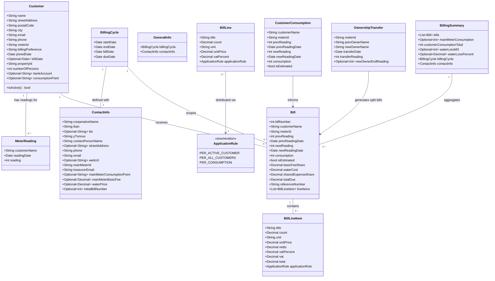

# Water Utility Billing CLI Tool

## Requirements

Implement a Finnish-language command-line tool that automates the complete billing workflow for a small water utility cooperative (~20 customers): ingest meter readings and configuration CSVs, compute per-customer water consumption and bill amounts, generate Finnish-standard bill PDFs with barcodes and virtual barcodes, email bills to customers, and produce a merged paper-bill PDF and treasurer billing summary. All user-facing text (CLI option names, help strings, CSV column headers, PDF content, email subject/body) must be in Finnish; source code identifiers in English. Data lives in CSV files on a local filesystem mounted from Google Drive. The project must include a Finnish-language `README.md` covering the billing workflow, all CSV file formats with column specifications, `.env` setup instructions, and cold-start seeding requirements. The tool is run once per billing cycle, which typically spans two calendar months; the `--kuukausi` option identifies the **last** month of that period. A fifth subcommand `uusi` must provide an interactive terminal wizard that guides the user through a complete billing cycle end-to-end: collecting and validating all required input files, generating the bills CSV, reviewing computed values, generating PDFs, and publishing — handling both first-run seeding and regular cycle setup.

## Entities



## Approach

1. CLI Architecture:
   - Use `typer` for Finnish-language CLI with four subcommands: `lasku` (generate bills CSV), `pdf` (generate bill PDFs), `julkaise` (publish — paper PDF + customer emails + yhteenveto PDF to treasurer), `uusi` (interactive wizard — full cycle setup through publish in one guided session)
   - Each subcommand accepts `--vuosi` (year), `--kuukausi` (integer 1–12, the last month of the billing period), and `--data-hakemisto` (data root path); together `--vuosi` and `--kuukausi` identify the billing run folder `<data_root>/<year>/<year>-<MM>/`
   - `julkaise` additionally requires SMTP credentials from `.env`; fail early with Finnish error if missing
   - Load `.env` via `python-dotenv` at startup

2. File Discovery:
   - Data root contains year folders; each year folder contains run subfolders named `<year>-<MM>` (e.g., `2026/2026-02/`); all files for a billing run reside in its run subfolder
   - Current run folder = `<data_root>/<year>/<year>-<MM>/` derived from `--vuosi` and `--kuukausi`; output files written to this folder
   - For fallback input types (`osakkaat`, `laskurivit`): search current run folder first; if not found, iterate all run subfolders in the same year and then the previous year, sorted by folder name descending (`<year>-<MM>` lexicographic order), return first folder that contains a matching `*-{type}-*.csv` file; within that folder pick the file with the latest date prefix ≤ cycle end date
   - `yleiset` uses cascade merge: collect all `*-yleiset-*.csv` files from current run folder and all preceding run folders (current year then previous year, descending by folder name); read each in order most-recent-first; merge key-value pairs with first occurrence of each key winning; validate all required keys present after merge
   - `lukemat` for current run is required in the current run folder; most recent previous `lukemat` is found by searching all run subfolders including the current one (current year then previous year, descending); no folder is excluded — same-cycle readings are excluded naturally by the `date < before_date` filter; this allows a seed `lukemat-alkutilanne` file placed in the current run folder to be discovered as a prior-cycle reading; second most recent `lukemat` loaded if available for estimated consumption fallback
   - `laskut` files are pure outputs; bill number counter initialised by scanning all `laskut` files across all run subfolders in all year folders; start from 1 if none exist

3. Consumption Computation:
   - For each active customer: look up name in current `lukemat`; if found compute `new_reading − prev_reading` where `prev_reading` comes from the most recent previous `lukemat`; if absent estimate consumption as `prev_reading − prev_prev_reading` (from the two most recent previous `lukemat` files) and flag `is_estimated = True`; if no `prev_prev` reading available emit a Finnish warning and use 0
   - Main meter consumption: current `päämittari` reading (from current `lukemat`) − previous `päämittari` reading (from most recent previous `lukemat` file)

4. Bill Line Distribution:
   - `PER_ACTIVE_CUSTOMER`: `ceil((count × unit_price) / num_active_customers)` per cent per active customer
   - `PER_ALL_CUSTOMERS`: `ceil((count × unit_price) / num_all_customers)` per cent per customer
   - `PER_CONSUMPTION`: `round(unit_price × consumption, 2)` per active customer (standard rounding)
   - Ceiling uses `decimal.ROUND_CEILING` after scaling by 100

5. PDF Generation:
   - `reportlab` for clean custom bill layout (A4, single-flow story, no multi-frame anchoring); barcode via `python-barcode`; virtual barcode as printed text string
   - `pypdf` for merging individual bill PDFs into `paperilaskut`
   - `yhteenveto` PDF uses same `reportlab` infrastructure with different two-table layout

6. Email Delivery:
   - `smtplib` with STARTTLS or SSL configurable via `.env`; plain-text body contains total, due date, IBAN, virtual barcode, reference number
   - Iterate email-preference customers; catch per-customer SMTP exceptions, log, continue
   - Send `yhteenveto` to treasurer after all customer emails attempted
   - Report succeeded/failed counts on completion

7. Reference Number (Viitenumero):
   - Isolated pure-function module; weights `[7, 3, 1]` cycling from right; check digit = `(10 − sum % 10) % 10`; append to base number
   - Unit-tested against known Finnish banking examples before first production use

8. Virtual Barcode (Virtuaaliviivakoodi v5):
   - Isolated pure-function module; format validated against Finanssiala specification test vectors
   - Structure: version `5` + IBAN account digits + amount (8 digits, cents) + reserved `000` + reference (23 digits, left-zero-padded) + due date (YYMMDD)

9. Mid-Cycle Ownership Transfer:
   - Detected when `lukemat` contains two rows for the same meter ID (prev owner at transfer date + optionally new owner at cycle end)
   - Basic fee split by calendar day ratio; all other charges to new owner; consumption attributed to new owner

## Structure

### I/O Functions (functional style, no class hierarchy)
1. `read_customers(path: Path) -> List[Customer]`
2. `read_bill_lines(path: Path) -> List[BillLine]`
3. `read_general_info(yleiset_paths: List[Path]) -> GeneralInfo`
4. `read_meter_readings(path: Path) -> List[MeterReading]`
5. `read_bill_numbers(path: Path) -> List[int]` — reads only `laskunumero` column from any `laskut` CSV file
6. `read_bills(path: Path) -> List[Bill]` — reads laskut CSV; `line_items` field initialised to `[]` (not persisted in CSV)
7. `write_bills(path: Path, bills: List[Bill], overwrite: bool = False) -> None`
8. `write_bill_lines(path: Path, bill_lines: List[BillLine], overwrite: bool = False) -> None`
9. `BillingError(Exception)` — Finnish user-facing error messages, exit code 1

### Dependencies
1. `lasku` command → file discovery functions → `validate_inputs` → `compute_consumptions` → `distribute_bill_line` → `generate_bills` → `write_bills`
2. `pdf` command → file discovery functions → `read_bills` → `distribute_bill_line` (line_items reconstruction) → `render_bill_pdf` → individual PDF files in run folder
3. `julkaise` command → file discovery functions → `merge_pdfs` + `render_summary_pdf` + `send_all_bills` + `send_summary_email`
4. `uusi` command → `run_cycle_wizard` → orchestrates all of the above service layer functions interactively via `typer.prompt` / `typer.confirm`
5. `ReferenceNumber` — pure function, no dependencies
6. `VirtualBarcode` — pure function, depends on `ReferenceNumber` formatted output
7. `send_all_bills` / `send_bill_email` / `send_summary_email` depend on `smtplib` + `_smtp_connection` context manager + `AppConfig`
8. `compute_consumptions` depends on `read_meter_readings` for current and up to two previous `lukemat` files; `read_bill_numbers` is used only to scan for the maximum bill number (optional — no file = start from 1)

### Layered Architecture
1. CLI Layer: `cli/commands.py` — typer app, Finnish subcommand definitions, orchestration calls
2. Service Layer: `services/billing.py`, `services/pdf.py`, `services/email.py`, `services/validation.py`
3. Domain Layer: `domain/models.py` (dataclasses), `domain/rules.py` (ApplicationRule enum, distribution logic)
4. I/O Layer: `io/csv_readers.py`, `io/csv_writers.py`, `io/file_discovery.py`
5. PDF Rendering Layer: `pdf/bill_renderer.py`, `pdf/summary_renderer.py`, `pdf/merger.py`
6. Encoding Layer: `encoding/reference_number.py`, `encoding/virtual_barcode.py` — isolated, fully unit-tested

### Project Layout
```
water_billing/
  cli/
    commands.py
  domain/
    models.py
    rules.py
  io/
    csv_readers.py
    csv_writers.py
    file_discovery.py
  services/
    billing.py
    pdf.py
    email.py
    validation.py
  pdf/
    bill_renderer.py
    summary_renderer.py
    merger.py
  encoding/
    reference_number.py
    virtual_barcode.py
  config.py
tests/
  test_reference_number.py
  test_virtual_barcode.py
  test_distribution.py
  test_consumption.py
pyproject.toml
README.md
.env.example
.gitignore
```

## Operations

### Create Domain Models — `domain/models.py`
1. Responsibility: Define all business entities as frozen Python dataclasses using `decimal.Decimal` for all monetary and meter reading values
2. Entities to define:
   - `Customer`: name: str, street_address: str, postal_code: str, city: str, email: str, phone: str, meter_id: str, billing_preference: str, joined_date: date, left_date: Optional[date], property_id: str, number_of_persons: int, bank_account: Optional[str], consumption_point: Optional[str]; method `is_active() -> bool` returns `bool(self.meter_id.strip())`; `bank_account` and `consumption_point` are stored but not used in any billing logic
   - `BillingCycle`: start_date: date, end_date: date, bill_date: date, due_date: date; `due_date` is always computed as `bill_date + timedelta(days=14)` and stored as a field for convenience; never set independently
   - `ContactInfo`: cooperative_name: str, iban: str, bic: Optional[str], y_tunnus: str, contact_person: str, street_address: Optional[str], phone: str, email: str, web_url: Optional[str], main_meter_id: str, treasurer_email: str, main_meter_consumption_point: Optional[str], main_meter_basic_fee: Optional[Decimal], water_price: Optional[Decimal], initial_bill_number: Optional[int]
   - `GeneralInfo`: billing_cycle: BillingCycle, contact_info: ContactInfo
   - `MeterReading`: customer_name: str, reading_date: date, reading: int
   - `BillLine`: title: str, count: Decimal, unit: str, unit_price: Decimal, vat_percent: Decimal, application_rule: ApplicationRule
   - `BillLineItem`: title: str, count: Decimal, unit: str, unit_price: Decimal, netto: Decimal, vat_percent: Decimal, vat: Decimal, total: Decimal, application_rule: ApplicationRule — represents one fully-computed line on a specific customer's bill; `netto`, `vat`, and `total` are pre-computed for the customer's share and must not be re-derived from count × unit_price for fixed distribution lines (ceiling rounding means the customer's netto is the ceiling split, not the raw quotient); `application_rule` is stored so callers can group line items by distribution type (e.g. the CSV writer groups by rule to compute per-category VAT-inclusive subtotals)
   - `CustomerConsumption`: customer_name: str, meter_id: str, prev_reading: int, prev_reading_date: date, new_reading: int, new_reading_date: date, consumption: int, is_estimated: bool
   - `Bill`: bill_number: int, customer_name: str, meter_id: str, prev_reading: int, prev_reading_date: date, new_reading: int, new_reading_date: date, consumption: int, is_estimated: bool, basic_fee_share: Decimal, water_cost: Decimal, shared_expense_share: Decimal, total_due: Decimal, reference_number: str, line_items: List[BillLineItem] — `basic_fee_share`, `water_cost`, and `shared_expense_share` are VAT-exclusive net subtotals per distribution category, used for internal computation; `total_due` is the VAT-inclusive grand total (sum of all `line_items[].total`) that represents the actual payment amount; `line_items` are per-customer fully-computed line items used by the PDF renderer and CSV writer; the `line_items` field itself is not written to the laskut CSV as a column
   - `OwnershipTransfer`: meter_id: str, prev_owner_name: str, new_owner_name: str, transfer_date: date, transfer_reading: int, new_owner_end_reading: Optional[int]
   - `BillingSummary`: bills: List[Bill], main_meter_consumption: Optional[int], customer_consumption_total: int, water_loss_m3: Optional[int], water_loss_percent: Optional[Decimal], billing_cycle: BillingCycle, contact_info: ContactInfo

### Create ApplicationRule Enum and Distribution Logic — `domain/rules.py`
1. `ApplicationRule(enum.Enum)`: `PER_ACTIVE_CUSTOMER = "aktiiviset"`, `PER_ALL_CUSTOMERS = "kaikki"`, `PER_CONSUMPTION = "kulutus"`
2. `ceil_cent(value: Decimal) -> Decimal`:
   - Logic: `return (value * 100).to_integral_value(rounding=ROUND_CEILING) / Decimal('100')`
3. `distribute_bill_line(line: BillLine, customers: List[Customer], consumptions: Dict[str, Decimal]) -> Dict[str, Decimal]`:
   - Logic:
     - `PER_ACTIVE_CUSTOMER`: active = [c for c in customers if c.is_active()]; netto = line.count * line.unit_price; per_share = ceil_cent(netto / len(active)); return {c.name: per_share for c in active}
     - `PER_ALL_CUSTOMERS`: netto = line.count * line.unit_price; per_share = ceil_cent(netto / len(customers)); return {c.name: per_share for c in customers}
     - `PER_CONSUMPTION`: return {c.name: (line.unit_price * consumptions.get(c.name, Decimal('0'))).quantize(Decimal('0.01'), rounding=ROUND_HALF_UP) for c in customers if c.is_active()}
     - Raise `BillingError` if active list is empty for PER_ACTIVE_CUSTOMER

### Implement Reference Number Algorithm — `encoding/reference_number.py`
1. Responsibility: Compute Finnish Viitenumero check digit and format reference number
2. `compute_reference_number(bill_number: int) -> str`:
   - Logic:
     - digits = list of int digits of str(bill_number), reversed
     - weights = cycle [7, 3, 1] from index 0
     - total = sum(d * w for d, w in zip(digits, weights))
     - check = (10 - total % 10) % 10
     - Return f"{bill_number}{check}"
3. `format_reference_number(reference: str) -> str`:
   - Group digits from right in blocks of max 5, space-separated (for PDF/email display)
4. Tests in `tests/test_reference_number.py`:
   - Test known Finnish banking example: `compute_reference_number(1234)` == `"12348"` (or per official spec vector)
   - Test check digit 0 case: total divisible by 10 → check digit is 0
   - Test `format_reference_number("12345678")` → `"123 45678"` (groups from right)

### Implement Virtual Barcode Encoder — `encoding/virtual_barcode.py`
1. Responsibility: Encode Finnish Virtuaaliviivakoodi version 5 per Finanssiala specification
2. `encode_virtual_barcode(iban: str, amount: Decimal, reference_number: str, due_date: date) -> str`:
   - Logic:
     - Strip spaces from iban; extract account digits (chars after 2-char country code + 2 check digits = iban[4:])
     - Pad account to 16 digits with leading zeros
     - Format amount as 8-digit string: euros (6 digits) + cents (2 digits), no separator (e.g., Decimal('12.50') → "00001250")
     - Strip spaces from reference_number; left-pad with zeros to 23 digits
     - Format due_date as YYMMDD (e.g., date(2026,3,31) → "260331")
     - Return "5" + account_16 + amount_8 + "000" + reference_23 + due_yymmdd
   - Total length: 1 + 16 + 8 + 3 + 23 + 6 = 57 characters
3. Tests in `tests/test_virtual_barcode.py`:
   - Validate against at least 3 test vectors from Finanssiala specification document
   - Test IBAN formatting, amount edge cases (zero, max), reference padding

### Implement File Discovery — `io/file_discovery.py`
1. `parse_date_prefix(filename: str) -> Optional[date]`:
   - Logic: try parsing first 8 chars as `%Y%m%d`; return date or None on failure
2. `run_folder(data_root: Path, year: int, month: int) -> Path`:
   - Return `data_root / str(year) / f"{year}-{month:02d}"`
3. `list_run_folders(data_root: Path, year: int) -> List[Path]`:
   - List all subdirectories of `data_root / str(year)` matching pattern `<year>-<MM>`; sort descending by name; return list (may be empty)
4. `find_with_fallback(data_root: Path, current_run: Path, year: int, file_type: str, at_or_before: date) -> Path`:
   - Search current_run for files matching `*-{file_type}-*.csv` (with note suffix) or `*-{file_type}.csv` (no note suffix) with date prefix ≤ at_or_before; when multiple match, prefer the file with the latest date prefix; if found return it
   - If not found: iterate `list_run_folders(year)` excluding current_run descending, then `list_run_folders(year − 1)` descending; for each folder apply the same dual-pattern search with date ≤ at_or_before; return first match
   - Raise `BillingError(f"Tiedostoa tyyppiä '{file_type}' ei löydy")` if no match found anywhere
5. `find_all_yleiset(data_root: Path, current_run: Path, year: int) -> List[Path]`:
   - Collect all run folders from `list_run_folders(year)` and `list_run_folders(year − 1)`, with current_run first; sort remaining folders descending by name
   - For each folder find all files matching `*-yleiset-*.csv` (with note suffix) or `*-yleiset.csv` (no note suffix), sorted by date prefix descending; append to result list
   - Return full ordered list (most recent first); may be empty — caller raises error if no yleiset files found at all
6. `find_all_laskut(data_root: Path) -> List[Path]`:
   - Glob all `<year>/<year>-<MM>` run subfolders under data_root; collect all `*-laskut-*.csv` (with note suffix) and `*-laskut.csv` (without note suffix) files; return full list (may be empty — caller starts bill counter from 1 if empty)
7. `find_previous_lukemats(data_root: Path, current_year: int, current_month: int, before_date: date) -> List[Path]`:
   - Collect all run folders from `list_run_folders(current_year)` and `list_run_folders(current_year − 1)`, **including** the current run folder, sorted descending by folder name; no folder is excluded — same-cycle readings are filtered out naturally by the `date < before_date` condition
   - For each folder find `*-lukemat-*.csv` files (with note suffix) **and** `*-lukemat.csv` files (without note suffix) with date < before_date; collect the latest-dated file per folder; return up to 2 paths (index 0 = most recent prev, index 1 = prev_prev)
   - Raise `BillingError("Ei aikaisempia lukematietoja löydy")` if result is empty
8. `output_path(run_dir: Path, cycle_end_date: date, file_type: str, note: str, extension: str) -> Path`:
   - If `note` is non-empty: return `run_dir / f"{cycle_end_date.strftime('%Y%m%d')}-{file_type}-{note}.{extension}"`
   - If `note` is empty string: return `run_dir / f"{cycle_end_date.strftime('%Y%m%d')}-{file_type}.{extension}"` (no trailing dash)

### Implement CSV Readers — `io/csv_readers.py`
1. All readers: `_open_csv(path: Path)` helper returns `open(path, encoding='utf-8-sig', newline='')` used by all reader functions
2. `read_customers(path: Path) -> List[Customer]`:
   - Finnish column names: `nimi`, `katuosoite`, `postinumero`, `postitoimipaikka`, `sähköposti`, `puhelin`, `kiinteistötunnus`, `henkilömäärä`, `liittynyt`, `lähtenyt`, `kulutuspiste`, `mittarinro`, `laskutustapa`, `tilinumero`
   - meter_id may be empty string (inactive customer)
   - Parse dates with `date.fromisoformat()`; lähtenyt is optional (empty string → None)
   - `tilinumero` and `kulutuspiste` read and stored as-is; empty string stored as None; not used in any billing computation
3. `read_bill_lines(path: Path) -> List[BillLine]`:
   - Finnish column names: `nimike`, `määrä`, `yksikkö`, `a-hinta`, `netto`, `alv-%`, `alv`, `yhteensä`, `soveltamistapa`
   - Parse: `count = Decimal(row['määrä'])`, `unit = row['yksikkö']`, `unit_price = Decimal(row['a-hinta'])`, `vat_percent = Decimal(row['alv-%'])`, `application_rule = ApplicationRule(row['soveltamistapa'])`
   - `netto`, `alv`, and `yhteensä` columns are read for human-readability validation only; if `netto` does not equal `count × unit_price` (within 0.001 tolerance) emit a Finnish warning; billing computation always uses `count` and `unit_price` as authoritative
   - Parse `soveltamistapa` → `ApplicationRule` enum value; raise `BillingError` on unknown value
4. `read_general_info(yleiset_paths: List[Path]) -> GeneralInfo`:
   - Each file has two columns: `avain` (key) and `arvo` (value); one row per setting
   - Process files in order (most recent first); build merged dict where first occurrence of each key wins
   - Required keys: `jakso_alkaa`, `jakso_loppuu`, `osuuskunnan_nimi`, `iban`, `y_tunnus`, `yhteyshenkilö`, `puhelin`, `sähköposti`, `päämittarinro`, `rahastonhoitajan_sähköposti`
   - Optional keys: `laskupäivä` (date in YYYY-MM-DD format; if absent, default to `date.today()`); `bic` (BIC/SWIFT code for the cooperative's bank account; used in the tilisiirto payment form on the bill PDF; defaults to None if absent); `osoite` (text — the cooperative's street address including postal code and city, e.g. "Metsätie 3, 12345 Metsälä"; displayed in the bill PDF footer on the first contact line alongside contact person name; defaults to None if absent); `www` (text — the cooperative's website URL; displayed in the bill PDF footer below the bank account line; defaults to None if absent); `päämittarin_kulutuspiste` (consumption point identifier for the main meter; defaults to None if absent); `päämittarin_perusmaksu` (Decimal, the total main meter basic fee in euros, VAT-exclusive, to be split among all active customers via PER_ACTIVE_CUSTOMER distribution; defaults to None if absent); `vesihinta` (Decimal, the water unit price in euros per m³, VAT-exclusive; defaults to None if absent); `aloituslaskunumero` (positive integer, the bill number to use as the starting point for the next billing run; takes priority over the automatic counter derived from prior `laskut` files; when not set, the counter advances from `max(existing bill numbers) + 1` or defaults to 1; defaults to None if absent)
   - Raise `BillingError` listing any missing keys if not all required keys present after merge
   - Parse date values with `date.fromisoformat()`; compute `due_date = bill_date + timedelta(days=14)`; construct and return `GeneralInfo`; map `rahastonhoitajan_sähköposti` → `ContactInfo.treasurer_email`; map `bic` → `ContactInfo.bic` (None if key absent); map `osoite` → `ContactInfo.street_address` (None if key absent); map `www` → `ContactInfo.web_url` (None if key absent); map `päämittarin_kulutuspiste` → `ContactInfo.main_meter_consumption_point` (None if key absent); map `päämittarin_perusmaksu` → `ContactInfo.main_meter_basic_fee` (parse as Decimal, None if absent); map `vesihinta` → `ContactInfo.water_price` (parse as Decimal, None if absent); map `aloituslaskunumero` → `ContactInfo.initial_bill_number` (parse as positive int, None if absent)
   - If `yleiset_paths` is empty: raise `BillingError("Yleiset-tiedostoa ei löydy")`
5. `read_meter_readings(path: Path) -> List[MeterReading]`:
   - Finnish column names: `nimi`, `päivämäärä`, `lukema`
   - Parse `lukema` as `int(row['lukema'])`; include `päämittari` row without filtering
6. `read_bill_numbers(path: Path) -> List[int]`:
   - Open file with `encoding='utf-8-sig'`; read only the `laskunumero` column via `csv.DictReader`; return list of parsed integers; skip rows where the column is absent or unparseable
7. `read_bills(path: Path) -> List[Bill]`:
   - Reads a laskut CSV and returns `List[Bill]`; initialises `line_items=[]` because the field is not persisted in the CSV; used by the `pdf` command to load previously generated bills before reconstructing line items in memory

### Implement Bill CSV Writer — `io/csv_writers.py`
1. `write_bills(path: Path, bills: List[Bill], overwrite: bool = False) -> None`:
   - Finnish column headers: `laskunumero`, `nimi`, `mittarinro`, `ed_lukema`, `ed_lukema_pvm`, `uusi_lukema`, `uusi_lukema_pvm`, `kulutus`, `arvio`, `perusmaksu_osuus`, `vesimaksu`, `yhteiskustannukset`, `yhteensä`, `viitenumero`
   - Open with `encoding='utf-8-sig'`, `newline=''`
   - Bool `is_estimated` written as `"kyllä"/"ei"`
   - Monetary columns (`perusmaksu_osuus`, `vesimaksu`, `yhteiskustannukset`, `yhteensä`) are written as VAT-inclusive totals derived from `bill.line_items`: `perusmaksu_osuus` = sum of `BillLineItem.total` for items where `application_rule == PER_ACTIVE_CUSTOMER`; `vesimaksu` = sum for `PER_CONSUMPTION` items; `yhteiskustannukset` = sum for `PER_ALL_CUSTOMERS` items; `yhteensä` = `bill.total_due` (sum of all line items' `total`); all written with period separator to 2 decimal places; meter reading and consumption fields written as plain integers (no decimal point)
   - `line_items` field of Bill is not written to the CSV as a column
   - Raise `BillingError` with Finnish message if output path already exists (unless `--ylikirjoita` flag set)
2. `write_bill_lines(path: Path, bill_lines: List[BillLine], overwrite: bool = False) -> None`:
   - Finnish column headers: `nimike`, `määrä`, `yksikkö`, `a-hinta`, `netto`, `alv-%`, `alv`, `yhteensä`, `soveltamistapa`
   - Open with `encoding='utf-8-sig'`, `newline=''`
   - Compute derived columns per row: `netto = count × unit_price` (quantized to 0.01 with ROUND_HALF_UP); `alv = netto × vat_percent / 100` (quantized to 0.01 with ROUND_HALF_UP); `yhteensä = netto + alv`
   - Write `application_rule` as its enum value string (e.g., `"aktiiviset"`)
   - Monetary amounts written with period separator to 2 decimal places; `määrä` written with period separator to 2 decimal places (count may be fractional)
   - Raise `BillingError` with Finnish message if output path already exists (unless `--ylikirjoita` flag set)

### Implement Consumption Engine — `services/billing.py`
1. `compute_consumptions(customers: List[Customer], current_readings: List[MeterReading], prev_readings: List[MeterReading], prev_prev_readings: List[MeterReading], cycle_end_date: date) -> List[CustomerConsumption]`:
   - Build lookup: `current_by_name = {r.customer_name: r for r in current_readings if r.customer_name != 'päämittari'}`
   - Build lookup: `prev_by_name = {r.customer_name: r for r in prev_readings if r.customer_name != 'päämittari'}`
   - Build lookup: `prev_prev_by_name = {r.customer_name: r for r in prev_prev_readings if r.customer_name != 'päämittari'}`
   - For each active customer c:
     - prev_r = prev_by_name.get(c.name); if None raise `BillingError(f"Ei edellisiä lukemia asiakkaalle: {c.name}")`
     - If c.name in current_by_name: new_r = current_by_name[c.name]; is_estimated = False; consumption = new_r.reading − prev_r.reading; new_reading = new_r.reading; new_date = new_r.reading_date
     - Else: is_estimated = True; new_date = cycle_end_date; if c.name in prev_prev_by_name: consumption = prev_r.reading − prev_prev_by_name[c.name].reading; else: consumption = 0; emit `typer.echo(f"Varoitus: ei kahta edellistä lukemaa, kulutus arvioidaan nollaksi: {c.name}", err=True)`; new_reading = prev_r.reading + consumption
     - Append CustomerConsumption(customer_name=c.name, meter_id=c.meter_id, prev_reading=prev_r.reading, prev_reading_date=prev_r.reading_date, new_reading=new_reading, new_reading_date=new_date, consumption=consumption, is_estimated=is_estimated)
   - Return list

2. `compute_main_meter_consumption(current_readings: List[MeterReading], prev_lukemat_path: Optional[Path]) -> Optional[int]`:
   - Find row with customer_name == 'päämittari' in current_readings; if absent return None
   - If prev_lukemat_path is None: return None
   - Read prev lukemat; find 'päämittari' row; if absent return None; return current.reading − prev.reading as plain int

### Implement Bill Generation Engine — `services/billing.py`
1. `get_next_bill_number(all_laskut_paths: List[Path], initial_bill_number: Optional[int] = None) -> int`:
   - Priority 1: if `initial_bill_number` is not None (from `ContactInfo.initial_bill_number` cascaded from `yleiset`), return `initial_bill_number`
   - Priority 2: if `all_laskut_paths` is non-empty, collect all parseable bill numbers from every path via `read_bill_numbers`; if any numbers found, return `max(all_values) + 1`
   - Priority 3 (final fallback): return 1
   - Rationale: `aloituslaskunumero` from `yleiset` gives the cooperative explicit control over the bill counter; when not set, the counter advances automatically from prior `laskut` files

2. `generate_bills(customers: List[Customer], consumptions: List[CustomerConsumption], bill_lines: List[BillLine], billing_cycle: BillingCycle, start_bill_number: int) -> List[Bill]`:
   - consumption_by_name: Dict[str, Decimal] = {c.customer_name: Decimal(c.consumption) for c in consumptions}
   - For each bill_line, call `distribute_bill_line(line, customers, consumption_by_name)` → per-customer amount dicts; store all distribution results indexed by line
   - Accumulate per customer: basic_fee_share (sum of PER_ACTIVE_CUSTOMER distributions), water_cost (PER_CONSUMPTION), shared_expense_share (PER_ALL_CUSTOMERS)
   - Build `line_items` for each customer: for each BillLine, create a `BillLineItem` where:
     - `title = line.title`, `vat_percent = line.vat_percent`, `application_rule = line.application_rule`
     - For PER_CONSUMPTION lines: `count = consumption_by_name.get(customer_name, Decimal('0'))`, `unit = line.unit`, `unit_price = line.unit_price`, `netto = customer_amount_from_distribution`
     - For PER_ACTIVE_CUSTOMER / PER_ALL_CUSTOMERS lines: `count = line.count`, `unit = line.unit`, `unit_price = line.unit_price`, `netto = customer_amount_from_distribution` (the ceiling-split value)
     - In all cases: `vat = netto × vat_percent / 100` (quantized to 0.01 with ROUND_HALF_UP); `total = netto + vat`
   - Preserve the order of the `customers` list as received (which reflects osakkaat CSV row order); do NOT sort by name — bill numbers are assigned in osakkaat row order so the laskut CSV rows appear in the same sequence as osakkaat
   - Assign bill_number starting at start_bill_number; compute reference_number via `compute_reference_number`
   - `total_due = sum(item.total for item in line_items)` — the VAT-inclusive grand total; `basic_fee_share`, `water_cost`, and `shared_expense_share` remain the VAT-exclusive net subtotals (sum of distribution amounts per rule type) and are stored in the Bill for internal use
   - Return List[Bill] with line_items populated for each bill

### Implement Mid-Cycle Ownership Transfer Handling — `services/billing.py`
1. `detect_ownership_transfers(current_readings: List[MeterReading], customers: List[Customer]) -> List[OwnershipTransfer]`:
   - Build `name_to_meter = {c.name: c.meter_id for c in customers if c.is_active()}`
   - Group readings by meter_id: for each reading (excluding 'päämittari'), look up `name_to_meter[reading.customer_name]` to get the meter_id; append reading to `meter_readings_by_meter[meter_id]`; skip readings whose customer name is not found
   - For each meter_id with 2+ readings: sort by date ascending; first = prev owner reading at transfer_date; second = new owner reading at cycle end; look up both customer objects by name
   - Skip meter_id groups where either customer cannot be found in the customers list
   - Return List[OwnershipTransfer]

2. `split_bills_for_transfer(transfer: OwnershipTransfer, billing_cycle: BillingCycle, bill_lines: List[BillLine], all_customers: List[Customer], start_bill_number: int) -> Tuple[Bill, Bill]`:
   - total_days = (billing_cycle.end_date − billing_cycle.start_date).days
   - prev_days = (transfer.transfer_date − billing_cycle.start_date).days
   - new_days = total_days − prev_days
   - For PER_ACTIVE_CUSTOMER lines: prev_share = ceil_cent(per_customer_basic × (prev_days / total_days)); new_share = ceil_cent(per_customer_basic × (new_days / total_days))
   - All PER_CONSUMPTION and PER_ALL_CUSTOMERS lines go entirely to new owner
   - New owner consumption: if transfer.new_owner_end_reading present → end − transfer_reading; else 0 (no estimate available)
   - Create two Bill objects: prev_owner bill (basic_fee_share only, zero water_cost, `line_items=[]`) and new_owner bill (prorated basic + full other charges, `line_items=[]`); transfer bills do not populate `line_items` because the split logic computes per-category totals directly without constructing individual BillLineItems

### Implement Input Validation — `services/validation.py`
1. `validate_inputs(customers, bill_lines, general_info, meter_readings, prev_readings, prev_prev_readings) -> List[str]`:
   - Warnings (non-fatal): active customer missing from prev_readings (new customer, no reading in seed lukemat); active customer absent from current meter_readings and also absent from prev_prev_readings (estimated consumption will be zero); 'päämittari' absent from meter_readings (yhteenveto water loss will be incomplete)
   - Errors (fatal): no active customers; bill_lines empty; billing_cycle start ≥ end; IBAN fails format check (must be FI + 16 chars, 18 total)
   - Return list of Finnish message strings; caller prints warnings and raises BillingError for errors
2. `validate_iban(iban: str) -> bool`:
   - Strip spaces; check starts with "FI"; total length == 18; all chars after "FI" are digits

### Implement Config Loader — `config.py`
1. `AppConfig`: data_root: Path, smtp_host: str, smtp_port: int, smtp_user: str, smtp_password: str, use_tls: bool, treasurer_email: str
2. `load_config(data_root_override: Optional[Path] = None) -> AppConfig`:
   - Load `.env` via `python-dotenv`; read DATA_ROOT, SMTP_HOST, SMTP_PORT, SMTP_USER, SMTP_PASSWORD, SMTP_TLS, TREASURER_EMAIL
   - Apply data_root_override if provided
   - Return AppConfig with partial init (SMTP fields may be None/empty until julkaise needs them)
3. `require_smtp_config(config: AppConfig) -> None`:
   - Raise `BillingError("SMTP-asetukset puuttuvat .env-tiedostosta")` if any SMTP field empty

### Implement Finnish Bill PDF Renderer — `pdf/bill_renderer.py`

The bill uses a clean, simple custom layout. Use `reportlab.platypus` with `SimpleDocTemplate` on A4 with 20 mm margins. No tilisiirto form and no multi-frame layout — all content flows as a single story from top to bottom.

1. `render_bill_pdf(bill: Bill, general_info: GeneralInfo, customer: Customer, output_path: Path) -> None`:

   **Section 1 — Header**

   a. **Header row**: cooperative name (`ci.cooperative_name`) in large bold on the left; `"LASKU"` in large bold on the right — rendered as a two-cell `Table` spanning full width.

   b. **Thin horizontal rule** (grey line, full width): use `HRFlowable` with `width="100%"` and no extra Spacer flanking it beyond controlled vertical rhythm so the line spans exactly from the left content edge to the right content edge, matching the full width of all surrounding tables.

   **Section 2 — Billing info block**

   c. **Two-column info block** (using a `Table` with two cells side by side):
      - Left cell — customer address block: a small grey label `"Asiakas"` on the first line, then customer name, street_address, postal_code + city on separate lines.
      - Right cell — bill metadata grid: a compact two-column nested `Table` right-aligned to the page margin, rows in order:
        1. `"Laskunumero"` | `{bill.bill_number}`
        2. `"Laskupäivä"` | `{format_date_fi(cycle.bill_date)}`
        3. `"Eräpäivä"` | `{format_date_fi(cycle.due_date)}`
        4. `"Mittarinumero"` | `{bill.meter_id}`
        5. (only if `customer.consumption_point` is non-None) `"Käyttöpaikka"` | `{customer.consumption_point}`

   d. **Thin horizontal rule** (grey line, full width): same `HRFlowable` spec as (b) — `width="100%"`, spanning exactly from the left content edge to the right content edge.

   **Section 3 — Line items table**

   e. **Line items table** — 7 columns (no separate unit column; unit is appended to the quantity value):

      | (blank header) | Määrä | À-hinta | Netto € | Alv % | Alv € | Yht € |

      For each `BillLineItem` in `bill.line_items`, emit two rows:
      - Main row: `[item.title]` | `{item.count:.2f} {item.unit}` | `{item.unit_price:.2f}` | `{format_amount_fi(item.netto)}` | `{item.vat_percent:.2f}` | `{format_amount_fi(item.vat)}` | `{format_amount_fi(item.total)}`
      - Sub-row (spanning all columns, smaller italic font): `Rivin laskutusjakso: {format_date_fi(cycle.start_date)} – {format_date_fi(cycle.end_date)}`; for `PER_CONSUMPTION` items append a second sub-line: `Lukemat {bill.prev_reading} – {bill.new_reading}`

      The decimal separator in quantity and unit price columns uses comma (Finnish locale). Numeric cell values in columns 2–7 (Määrä through Yht €) must be visually right-aligned: use a right-aligned paragraph style (`alignment=TA_RIGHT`) for the `Paragraph` objects in those cells, in addition to the table-level `ALIGN RIGHT` directive, so that text flows right within the cell. Sub-rows and the header row use left-aligned paragraphs in column 0; header labels in columns 1–6 are also right-aligned. The table has an outer border only; no internal cell borders (no `INNERGRID`). The table must span the full available text width: set explicit `colWidths` so that they sum to `doc.width`; distribute the width so that the title column (column 0) receives the majority of the remaining space after fixed-width numeric columns are allocated.

   f. **VAT summary row** (right-aligned, spanning the last 3 columns, label `"Alv-erittely"` left of the numeric area):
      Shows the sum of all `item.netto` values, the VAT percentage (if all lines share one rate, show it; otherwise show each rate group separately), and the sum of all `item.vat` values.

   g. **Grand total row**: `"LASKU YHTEENSÄ:"` bold left-aligned + `"{format_amount_fi(bill.total_due)} euroa"` bold right-aligned, spanning full width.

   **Section 4 — Payment information**

   h. **Thick horizontal rule** (full width, slightly heavier weight than section rules): use `HRFlowable` with `width="100%"`, spanning exactly from the left content edge to the right content edge — the same bounds as all surrounding tables and the thin rules above.

   i. **"Maksutiedot"** label in bold, left-aligned: rendered as a `Paragraph` with a style that has `leftIndent=0` and `rightIndent=0` and `spaceBefore`/`spaceAfter` only — no extra left or right padding or indentation so it aligns flush with both content edges, matching the HRFlowable above it.

   j. **Payment details grid**: a compact two-column `Table` (label column left, value column right) constrained to the full available text width via explicit `colWidths` that sum to `doc.width`; the label column is fixed-width and the value column receives the remaining space; `LEFTPADDING` must be `0` for the label column and `RIGHTPADDING` must be `0` for the value column (or set both to `0` globally for all cells) so the label text starts flush with the left content edge and the value text ends flush with the right content edge — matching the HRFlowable and Maksutiedot heading above on both sides; rows in order:
      - `"Saaja"` | `{ci.cooperative_name}`
      - `"Tilinumero (IBAN)"` | `{ci.iban}` (if `ci.bic` is set, append `"  BIC: {ci.bic}"` to the same cell)
      - `"Viitenumero"` | `{format_reference_number(bill.reference_number)}`
      - `"Eräpäivä"` | `{format_date_fi(cycle.due_date)}`
      - `"Summa"` | `{format_amount_fi(bill.total_due)}` in bold
      - `"Virtuaaliviivakoodi"` | the full virtual barcode string in a monospace font

   **Section 5 — Barcode**

   k. **Barcode image**: Code 128 barcode generated from the virtual barcode string via `python-barcode` with `ImageWriter`; rendered at full available page width, approximately 20 mm tall, with no text caption below it.

   **Section 6 — Footer**

   l. **Page-bottom footer**: Rendered via a `PageTemplate` `onPage` callback on the underlying canvas, independent of the story flow, so it appears at a fixed position at the bottom of every page regardless of story content length. The `SimpleDocTemplate` `bottomMargin` must be set to at least 30 mm to reserve space and prevent story content from overflowing into the footer area. The footer layout:
      - A thin horizontal rule (grey, full width between left and right page margins) drawn 25 mm from the page bottom edge; drawn directly on the canvas from `doc.leftMargin` to `doc.width + doc.leftMargin` with no extra inset so it aligns with the content edges.
      - Below the rule, text split into two columns, both rendered in a small font (7–8 pt):
        - Left column: up to four lines in small regular weight —
          - Line 1: cooperative name in small bold.
          - Line 2: `ci.contact_person` and `ci.street_address` (included only if non-None), separated by a comma-space.
          - Line 3: `ci.phone` and `ci.email`, separated by a comma-space.
          - Line 4: `ci.web_url` (included only if non-None).
        - Right column (right-aligned to the right page margin): two lines in small regular weight —
          - Line 1: `"Y-tunnus: {ci.y_tunnus}"`.
          - Line 2: `"Tilinumero: {ci.iban}"` (append `"  BIC: {ci.bic}"` when `ci.bic` is set).
      - Footer text must not duplicate payment information that already appears in Section 4 — its purpose is contact identification, not payment instruction.

2. `format_amount_fi(amount: Decimal) -> str`:
   - Format with Finnish locale: comma decimal separator, exactly 2 decimal places, euro suffix (e.g., `"12,50 €"`); no space between digits and comma; one space before `€`.
3. `format_date_fi(d: date) -> str`: return `d.strftime('%d.%m.%Y')`

### Implement yhteenveto PDF Renderer — `pdf/summary_renderer.py`
1. `render_summary_pdf(summary: BillingSummary, output_path: Path) -> None`:
   - Use same reportlab infrastructure as bill_renderer
   - Title: `"Laskutusyhteenveto"` + period
   - Table 1 — Billing table: columns `Nimi`, `Summa (€)`, `Eräpäivä`, `Viitenumero`; one row per bill sorted by customer name; total row
   - Table 2 — Water loss table: row `Päämittari (m³)`, row `Asiakkaiden yhteiskulutus (m³)`, row `Häviö (m³)`, row `Häviö (%)`; show N/A if main meter reading absent
   - All Finnish labels; amounts in Finnish format

### Implement PDF Merger — `pdf/merger.py`
1. `merge_pdfs(input_paths: List[Path], output_path: Path) -> None`:
   - Use `pypdf.PdfWriter`; iterate input_paths in order; add all pages from each; write to output_path
2. `sort_bill_pdfs_alphabetically(pdf_paths: List[Path]) -> List[Path]`:
   - Parse customer surname from filename pattern `YYYYMMDD-lasku-sukunimi-etunimi.pdf`
   - Sort by (surname, firstname)

### Implement Email Sender — `services/email.py`
1. `_smtp_connection(config: AppConfig) -> Generator[smtplib.SMTP, None, None]`:
   - `@contextmanager`; if `config.use_tls`: open `smtplib.SMTP` + call `starttls()`; else open `smtplib.SMTP_SSL`; authenticate; yield server; call `quit()` on exit
2. `send_bill_email(config: AppConfig, bill: Bill, pdf_path: Path, general_info: GeneralInfo, customer: Customer, server: smtplib.SMTP) -> None`:
   - `customer` provides the recipient email address; `server` is a shared already-authenticated SMTP connection (opened once by `send_all_bills`)
   - Subject: f"Lasku {general_info.billing_cycle.end_date.year}/{bill.bill_number} — {general_info.contact_info.cooperative_name}"
   - Plain text body (Finnish): total, due date, IBAN, reference number (formatted), virtual barcode, contact info
   - Attach PDF; send via the provided `server` (no new connection opened here)
3. `send_summary_email(config: AppConfig, summary_pdf_path: Path, summary: BillingSummary) -> None`:
   - Recipient: `summary.contact_info.treasurer_email` if non-empty, else `config.treasurer_email`; raise `BillingError("Rahastonhoitajan sähköposti puuttuu sekä yleiset-tiedostosta että .env-tiedostosta")` if both are empty; subject: `"Laskutusyhteenveto {period}"`; attach yhteenveto PDF; opens its own `_smtp_connection`
4. `send_all_bills(config: AppConfig, bills: List[Bill], customers: List[Customer], pdf_dir: Path, general_info: GeneralInfo) -> Tuple[List[str], List[str]]`:
   - Returns (succeeded_names, failed_names)
   - Opens a single `_smtp_connection` shared for all customer emails; build customer lookup by name; only send to email-preference customers (`billing_preference.lower() == "sähköposti"`)
   - Derives PDF filename from bill customer name using the same `sukunimi-etunimi` convention as the `pdf` command
   - Per-customer try/except `smtplib.SMTPException`; append name to appropriate list; continue

### Create CLI Entry Point — `cli/commands.py`
1. `app = typer.Typer(name="laskutus", help="Vesiosuuskunnan laskutustyökalu")` 
2. `@app.command("lasku")` options: `--vuosi: int = current year`, `--kuukausi: int` (required, 1–12; last month of the billing period), `--data-hakemisto: Path`:
   - Construct `run_dir = run_folder(data_root, vuosi, kuukausi)`; ensure run_dir exists (create if absent)
   - Load config; discover files using `find_with_fallback` and `run_dir`; read all inputs including prev and prev_prev lukemat; scan all laskut files for bill number counter
   - Validate (print warnings, raise on errors)
   - Detect ownership transfers; compute consumptions (with transfer handling)
   - Generate bills using `get_next_bill_number(all_laskut_paths, general_info.contact_info.initial_bill_number)`; write laskut CSV to `output_path(run_dir, cycle.end_date, "laskut", "", "csv")` — no note suffix; filename: `YYYYMMDD-laskut.csv`
   - Print: `"Laskut kirjoitettu: {path} ({n} laskua)"`
3. `@app.command("pdf")` options: `--vuosi: int = current year`, `--kuukausi: int` (required), `--data-hakemisto: Path`:
   - Construct `run_dir`; read laskut CSV via `find_with_fallback` using `read_bills` (returns `line_items=[]`); read general_info, customers, and laskurivit via `find_with_fallback`
   - Reconstruct `line_items` in memory: build `consumption_by_name` from bills; call `distribute_bill_line` for each BillLine; for each bill iterate the distributions and construct `BillLineItem` objects (same logic as in `generate_bills`); attach to bill via `dataclasses.replace(bill, line_items=line_items)` before rendering
   - Render each customer's bill PDF; save to run_dir; skip bills whose customer is not found in the customers list
   - Print per-customer progress; final count
4. `@app.command("julkaise")` options: `--vuosi: int = current year`, `--kuukausi: int` (required), `--data-hakemisto: Path`:
   - Construct `run_dir`; require_smtp_config; read all needed CSVs via `find_with_fallback`
   - Render and save paperilaskut PDF for paper-preference customers (sorted alphabetically) to run_dir
   - Render and save yhteenveto PDF to run_dir
   - send_all_bills; print succeeded/failed counts
   - send_summary_email to treasurer; print result
5. `def main()`: `app()` entry point registered in pyproject.toml `[project.scripts]`

### Implement uusi Wizard — `services/wizard.py` + `cli/commands.py`
1. Add `@app.command("uusi")` with options `--vuosi: int = current year`, `--kuukausi: int` (required), `--data-hakemisto: Path` to `cli/commands.py`; it constructs `run_dir` and delegates to `run_cycle_wizard(config, run_dir, year, month)`
2. Implement `run_cycle_wizard(config: AppConfig, run_dir: Path, year: int, month: int) -> None` in `services/wizard.py` with the following sequential phases; each phase uses `typer.echo` for output and `typer.prompt` / `typer.confirm` for input; Finnish text throughout:

   **Phase 1 — yleiset**
   - Call `find_all_yleiset(data_root, run_dir, year)` to get ordered list of existing yleiset files
   - Attempt merge of all found files to build current values dict (`resolved`)
   - Compute default dates from `vuosi` and `kuukausi` (using Python `calendar` module):
     - `jakso_alkaa_default`: first day of the month preceding `kuukausi`; if `kuukausi == 1`, use `date(vuosi − 1, 12, 1)`; otherwise `date(vuosi, kuukausi − 1, 1)`; format as ISO date string (`YYYY-MM-DD`)
     - `jakso_loppuu_default`: last day of `kuukausi` in `vuosi`, computed via `date(vuosi, kuukausi, calendar.monthrange(vuosi, kuukausi)[1])`; format as ISO date string
   - **Display resolved values**: if `resolved` is non-empty, print a summary of all currently resolved key-value pairs in canonical key order; for `päämittarin_perusmaksu` and `vesihinta` append `"(alv 0%)"` to the displayed value to make clear these are VAT-exclusive amounts
   - **Ask about changes**: if `resolved` is non-empty and all required keys are present, prompt `typer.confirm("Haluatko muuttaa joitain yleiset-asetuksia?", default=False)` — store result as `wants_changes`; if `resolved` is empty or any required key is missing, set `wants_changes = True` implicitly
   - **Change loop** (runs only if `wants_changes` is True): for each key in canonical order (`jakso_alkaa`, `jakso_loppuu`, `laskupäivä`, `osuuskunnan_nimi`, `iban`, `bic`, `osoite`, `www`, `y_tunnus`, `yhteyshenkilö`, `puhelin`, `sähköposti`, `päämittarinro`, `rahastonhoitajan_sähköposti`, `päämittarin_kulutuspiste`, `päämittarin_perusmaksu`, `vesihinta`, `aloituslaskunumero`) that already has a resolved value: display the current value and prompt `"Muuta arvoa? (tyhjä = pidä nykyinen)"` — if user enters non-empty string, update the value; else keep existing value
   - **Missing-key loop** (always runs regardless of `wants_changes`): for each key in canonical order that is ABSENT from the (possibly updated) values dict; `laskupäivä`, `bic`, `osoite`, `www`, `päämittarin_kulutuspiste`, `päämittarin_perusmaksu`, `vesihinta`, and `aloituslaskunumero` are optional — all others are required:
     - For `jakso_alkaa`: prompt `"Jakso alkaa (oletus: {jakso_alkaa_default}):"` — if user enters empty, use `jakso_alkaa_default`; accept non-empty input as override
     - For `jakso_loppuu`: prompt `"Jakso loppuu (oletus: {jakso_loppuu_default}):"` — if user enters empty, use `jakso_loppuu_default`; accept non-empty input as override
     - For `laskupäivä`: prompt `"Laskupäivä (oletus: tänään {date.today().isoformat()}):"` — if user enters empty, use `date.today()`; accept non-empty ISO date as override; `eräpäivä` is automatically set to `laskupäivä + 14 days` and echoed to the user for confirmation (`"Eräpäivä: {due_date.strftime('%d.%m.%Y')}"`)
     - For `bic`: prompt `"Pankin BIC/SWIFT-koodi (valinnainen, tyhjä = ei määritelty):"` — store value if non-empty, else omit key from output (stored as None)
     - For `osoite`: prompt `"Osuuskunnan osoite (valinnainen, näytetään laskun alatunnisteessa, tyhjä = ei määritelty):"` — store value if non-empty, else omit key from output (stored as None)
     - For `www`: prompt `"Osuuskunnan www-osoite (valinnainen, näytetään laskun alatunnisteessa tilinumeron jälkeen, tyhjä = ei määritelty):"` — store value if non-empty, else omit key from output (stored as None)
     - For `päämittarin_kulutuspiste`: prompt `"Päämittarin kulutuspiste (valinnainen, tyhjä = ei määritelty):"` — store value if non-empty, else omit key from output (stored as None)
     - For `päämittarin_perusmaksu`: prompt `"Päämittarin perusmaksu yhteensä (€ alv 0%, valinnainen, tyhjä = ei määritelty):"` — if non-empty, validate parseable as Decimal and store; else omit key (stored as None); this is the total main meter fee to be split among active customers, not a per-customer amount
     - For `vesihinta`: prompt `"Vesihinta (€/m³ alv 0%, valinnainen, tyhjä = ei määritelty):"` — if non-empty, validate parseable as Decimal and store; else omit key (stored as None)
     - For `aloituslaskunumero`: prompt `"Aloituslaskunumero (valinnainen, tyhjä = käytä automaattista numerointia):"` — if non-empty, validate parseable as a positive integer and store; else omit key (stored as None); when set, this value takes priority over any prior `laskut` file counter; when not set, the counter advances automatically from `max(existing bill numbers) + 1` or defaults to 1
     - For all other keys: prompt `"Anna arvo avaimelle {key}:"` (required, repeat until non-empty)
   - If any value was changed or any missing required key was filled: write new yleiset CSV to current run folder named `{cycle_start_date.strftime('%Y%m%d')}-yleiset.csv` (where `cycle_start_date` is `jakso_alkaa` parsed from the collected values); write all collected key-value pairs (omit optional keys whose value is empty: `bic`, `osoite`, `www`, `päämittarin_kulutuspiste`, `päämittarin_perusmaksu`, `vesihinta`); echo `"Yleiset-asetukset tallennettu: {path}"`
   - Else: echo `"Yleiset-asetukset muuttumattomia, ei uutta tiedostoa."`
   - Parse merged values into `GeneralInfo`

   **Phase 2 — osakkaat**
   - Attempt `find_with_fallback(data_root, run_dir, year, 'osakkaat', cycle_end_date)` — catch not-found
   - If not found: write placeholder osakkaat CSV with header row only (`nimi,katuosoite,postinumero,postitoimipaikka,sähköposti,puhelin,kiinteistötunnus,henkilömäärä,liittynyt,lähtenyt,kulutuspiste,mittarinro,laskutustapa,tilinumero`) to current run folder named `{cycle_start_date.strftime('%Y%m%d')}-osakkaat.csv` (using the `jakso_alkaa` date parsed in Phase 1); echo `"Osakkaat-tiedosto luotu: {path}. Täytä asiakastiedot tiedostoon ja käynnistä 'uusi' uudelleen."` ; return (exit wizard)
   - If found: echo path; if `typer.confirm("Onko osakkaat-tiedostossa muutoksia?", default=False)`: echo `"Päivitä tiedosto ja käynnistä 'uusi' uudelleen."` ; return (exit wizard)
   - Read customers from found file

   **Phase 3 — lukemat**
   - Attempt `find_previous_lukemats(data_root, year, month, jakso_alkaa)` and catch `BillingError` (empty result); store result as `prev_lukemat_paths` (empty list if not found)
   - **First-run seed phase** (only if `prev_lukemat_paths` is empty):
     - Echo `"Ensimmäinen laskutusjakso havaittu. Syötä alkutilanteen mittarilukemat ennen nykyjakson lukemia."`
     - `seed_date = jakso_alkaa - timedelta(days=1)` (last day of the preceding cycle)
     - Use osakkaat CSV row order (filtered to active customers); for each customer prompt `"Alkutilanne – {c.name} (m³):"` ; if non-empty and parseable as int, collect as MeterReading with `seed_date`; if empty, skip with warning
     - Prompt `"Päämittarin alkutilanne (m³):"` ; if provided add MeterReading with name `päämittari` and `seed_date`; if empty emit warning `"Varoitus: päämittarin alkutilanne puuttuu."`
     - Write seed lukemat CSV to current run folder named `{seed_date.strftime('%Y%m%d')}-lukemat-alkutilanne.csv`; echo `"Alkutilanne tallennettu: {path}"`
     - Store seed readings as `prev_readings` for Phase 5 (do not call `find_previous_lukemats` again); set `prev_prev_readings = []`
   - **Check for existing current-period lukemat**: search run_dir for `*-lukemat-*.csv` files (with note suffix) and `*-lukemat.csv` files (without note suffix), excluding any file with `-alkutilanne` in the name; if multiple match, pick the one with the latest date prefix; store as `existing_lukemat_path` (or None if not found)
   - If `existing_lukemat_path` is not None:
     - Read the existing lukemat and display readings as a table (customer name, reading value, reading date)
     - Prompt `typer.confirm("Haluatko muuttaa mittarilukemia?", default=False)` — store as `wants_reading_changes`
     - If `wants_reading_changes` is False: proceed to Phase 4 using `existing_lukemat_path` as the current lukemat (no new file written)
     - If `wants_reading_changes` is True: build `existing_by_name` dict `{customer_name: reading_int}` from the existing file; use osakkaat CSV row order (filtered to active customers); for each customer prompt `"Lukema – {c.name} (m³) [nykyinen: {existing_by_name.get(c.name, '–')}]:"` — if user enters empty and an existing reading is present, keep that reading; if user enters empty and no existing reading, skip; if non-empty and parseable as int, collect as updated MeterReading with today's date; for päämittari prompt `"Päämittarin lukema (m³) [nykyinen: {existing}]:"` — if empty and existing value present, keep existing; if empty and no existing, emit warning; write updated lukemat CSV named `{today.strftime('%Y%m%d')}-lukemat.csv` (no note suffix); echo `"Lukemat päivitetty: {path}"`
   - If `existing_lukemat_path` is None:
     - Echo `"Syötä mittarilukemat. Paina Enter ohittaaksesi asiakkaan (ei lukemaa tällä jaksolla)."`
     - Use osakkaat CSV row order (filtered to active customers); for each customer prompt `"Lukema – {c.name} (m³):"` ; if non-empty and parseable as int, collect as MeterReading with today's date; if empty, skip
     - Prompt `"Päämittarin lukema (m³):"` ; if provided add MeterReading with name `päämittari`; if empty emit warning `"Varoitus: päämittarin lukema puuttuu — vesihäviö jää laskematta yhteenvedossa."`
     - Write lukemat CSV to current run folder named `{cycle_end_date.strftime('%Y%m%d')}-lukemat.csv` (no note suffix); echo `"Lukemat tallennettu: {path}"`
   - If `prev_lukemat_paths` was non-empty (normal run): load `prev_readings` and `prev_prev_readings` from those paths as usual for Phase 5

   **Phase 4 — laskurivit**
   - Attempt `find_with_fallback` for `laskurivit`; catch not-found
   - If not found:
     - Compute `cycle_months = (jakso_loppuu.year * 12 + jakso_loppuu.month) - (jakso_alkaa.year * 12 + jakso_alkaa.month) + 1` (number of full calendar months spanned by the billing cycle; typically 2)
     - For Perusmaksu: if `general_info.contact_info.main_meter_basic_fee` is set (the monthly total fee from yleiset), echo `"Päämittarin perusmaksu yleiset-tiedostosta: {value} € (alv 0%, per kuukausi)"` and prompt `"Muuta? (tyhjä = käytä yleiset-arvoa):"` — use yleiset value if empty, otherwise use user input as the monthly fee; else prompt `"Päämittarin perusmaksu yhteensä (€ alv 0%, per kuukausi):"` (required); echo `"Perusmaksun laskutusjakson summa: {monthly_fee * cycle_months} € ({cycle_months} kk)"` so the user can confirm; Perusmaksu BillLine: title=`"Perusmaksu"`, count=`Decimal(cycle_months)`, unit=`"kk"`, unit_price=monthly_fee, application_rule=PER_ACTIVE_CUSTOMER; distribution engine computes netto=`cycle_months × monthly_fee` and ceiling-splits per active customer automatically
     - For Vesimaksu: if `general_info.contact_info.water_price` is set, echo `"Vesihinta yleiset-tiedostosta: {value} €/m³ (alv 0%)"` and prompt `"Muuta? (tyhjä = käytä yleiset-arvoa):"` — use yleiset value if empty; else prompt `"Vesimaksu (€/m³ alv 0%):"` (required); Vesimaksu BillLine: title=`"Vesimaksu"`, count=`Decimal('1')`, unit=`"m³"`, unit_price=water_price, application_rule=PER_CONSUMPTION; `count=1` is a CSV placeholder — the PDF renderer uses each customer's actual consumption as `määrä` for PER_CONSUMPTION rows
     - Prompt `"ALV-% (perusmaksu):"` and `"ALV-% (vesimaksu):"` for each line separately; VAT percentages are stored in the laskurivit CSV and applied during PDF generation — prices from yleiset are always VAT-exclusive
     - Create bill_lines list with the two constructed BillLine rows
   - If found: echo `"Nykyiset laskurivit:"` followed by formatted table of bill lines (nimike, määrä, yksikkö, a-hinta, alv-%, soveltamistapa); set bill_lines = loaded lines
   - **Additional expenses loop** (runs in both found and not-found cases, after base lines are established):
     - Loop: if `typer.confirm("Lisätäänkö lisäkustannusrivi (esim. yhteiskulut)?", default=False)`: prompt `"Nimike:"`, `"Määrä:"`, `"Yksikkö:"`, `"À-hinta (€):"`, `"ALV-%:"`, `"Soveltamistapa (aktiiviset/kaikki/kulutus):"` ; validate soveltamistapa against `ApplicationRule` values; on invalid value echo Finnish error and re-prompt; create BillLine(title, count=Decimal(määrä input), unit, unit_price=Decimal(a-hinta input), vat_percent=Decimal(alv input), application_rule); append to bill_lines; repeat loop
   - If bill_lines differ from what was in the found file (or no file was found): call `write_bill_lines` to write laskurivit CSV named `{cycle_end_date.strftime('%Y%m%d')}-laskurivit.csv` (no note suffix) to current run folder; echo `"Laskurivit tallennettu: {path}"`

   **Phase 5 — generate laskut and review**
   - Run consumption and bill computation (same logic as `lasku` command) using the inputs collected above
   - Print results table: one row per customer with name, consumption m³ (real/estimated flag), basic fee, water cost, shared expenses, total due
   - Print total bill count and sum
   - Write laskut CSV named `{cycle_end_date.strftime('%Y%m%d')}-laskut.csv` (no note suffix) to current run folder
   - If `typer.confirm("Ovatko laskut oikein?", default=True)` is False: echo `"Tarkista syöttötiedot ja käynnistä 'uusi' uudelleen."` ; return

   **Phase 6 — generate PDFs and review**
   - Generate individual bill PDFs and yhteenveto PDF (same logic as `pdf` command)
   - Echo `"PDF-laskut generoitu: {n} laskua + yhteenveto."` and folder path
   - If `typer.confirm("Julkaistaanko laskut nyt?", default=True)` is False: echo `"Laskut on tallennettu. Julkaise myöhemmin komennolla 'julkaise'."` ; return

   **Phase 7 — publish**
   - Call `require_smtp_config(config)` ; if fails print Finnish SMTP error and return
   - Run publish logic (same as `julkaise` command): send customer emails, produce paperilaskut PDF, send yhteenveto to treasurer
   - Print succeeded/failed email counts and confirmation

### Create README.md
1. Write `README.md` in Finnish at the project root. Content must cover the following sections in order:
   - **Yleiskuvaus**: What the tool is, who it is for (~20 customer water cooperative), and that it automates the billing cycle which typically spans two calendar months; note that `--kuukausi` identifies the **last** month of the period
   - **Asennus**: Install via `pip install -e .`; copy `.env.example` to `.env` and fill in SMTP credentials and data root path; list all required `.env` variables (`DATA_ROOT`, `SMTP_HOST`, `SMTP_PORT`, `SMTP_USER`, `SMTP_PASSWORD`, `SMTP_TLS`); note that `TREASURER_EMAIL` in `.env` is optional and acts as a fallback — the primary source for the treasurer email is the `rahastonhoitajan_sähköposti` key in `yleiset` CSV
   - **Laskutustyönkulku**: The billing workflow as a numbered list matching the 8-step cycle — create/update `osakkaat` if changed; create/update `laskurivit` if changed; create `yleiset` for the cycle; create `lukemat` for the cycle; run `laskutus lasku` to generate `laskut` CSV; inspect and optionally edit `laskut` CSV; run `laskutus pdf` to generate bill PDFs; inspect PDFs; run `laskutus julkaise` to send emails, merge paper bills, and email `yhteenveto` to treasurer
   - **Komennot**: Table or list of all four subcommands (`laskutus uusi`, `laskutus lasku`, `laskutus pdf`, `laskutus julkaise`) with their options (`--vuosi`, `--kuukausi`, `--data-hakemisto`, `--ylikirjoita`, `--lähetä-uudelleen`) and a one-line Finnish description for each; note that `uusi` is the recommended entry point for new users and covers the entire workflow interactively
   - **Tiedostorakenne**: Explain the two-level folder layout — year folder (`2026/`) containing run subfolders named `<vuosi>-<KK>` (e.g., `2026/2026-02/` for a February cycle); explain that all files for one billing run live in its run subfolder; explain the `VVVVKKPP-tyyppi-lisätieto.csv` file naming convention; list each file type (`osakkaat`, `laskurivit`, `yleiset`, `lukemat`, `laskut`, `lasku`, `paperilaskut`, `yhteenveto`) with a one-line Finnish description of whether it is input or output
   - **CSV-tiedostomuodot**: One subsection per input CSV file type with a table showing column name (Finnish), data type, and description:
     - `osakkaat`: `nimi` (teksti), `katuosoite` (teksti), `postinumero` (teksti), `postitoimipaikka` (teksti), `sähköposti` (teksti), `puhelin` (teksti), `kiinteistötunnus` (teksti), `henkilömäärä` (kokonaisluku), `liittynyt` (päivämäärä YYYY-MM-DD), `lähtenyt` (päivämäärä tai tyhjä), `kulutuspiste` (teksti, varattu tulevaa käyttöä varten — ei käytetä laskennassa), `mittarinro` (teksti, tyhjä = ei aktiivinen), `laskutustapa` (sähköposti/paperi), `tilinumero` (teksti, vain tiedoksi — ei käytetä laskennassa)
     - `laskurivit`: `nimike` (teksti), `määrä` (desimaaliluku — kappalemäärä tai ajanjaksomäärä, esim. 2 kuukautta), `yksikkö` (teksti, esim. `kk` tai `m³`), `a-hinta` (desimaaliluku — yksikköhinta alv 0%), `netto` (desimaaliluku, laskennallinen — `määrä × a-hinta`), `alv-%` (desimaaliluku), `alv` (desimaaliluku, laskennallinen), `yhteensä` (desimaaliluku, laskennallinen — `netto + alv`), `soveltamistapa` (aktiiviset / kaikki / kulutus); `netto`, `alv` ja `yhteensä` ovat viitetietoja — laskennassa käytetään `määrä`- ja `a-hinta`-sarakkeita
     - `yleiset`: key-value format with two columns `avain` and `arvo`; one row per setting; valid keys and their types: `jakso_alkaa` (YYYY-MM-DD, pakollinen), `jakso_loppuu` (YYYY-MM-DD, pakollinen), `laskupäivä` (YYYY-MM-DD, valinnainen — oletuksena kuluva päivä), `osuuskunnan_nimi` (teksti, pakollinen), `iban` (teksti, pakollinen), `bic` (teksti, valinnainen — pankin BIC/SWIFT-koodi; näytetään laskun tilisiirto-osassa), `osoite` (teksti, valinnainen — osuuskunnan katuosoite postinumeroineen ja postitoimipaikkoineen; näytetään laskun alatunnisteessa ensimmäisellä yhteystietorivillä), `www` (teksti, valinnainen — osuuskunnan www-osoite; näytetään laskun alatunnisteessa tilinumeron jälkeen; siirtyy jaksojen yli), `y_tunnus` (teksti, pakollinen), `yhteyshenkilö` (teksti, pakollinen), `puhelin` (teksti, pakollinen), `sähköposti` (teksti, pakollinen), `päämittarinro` (teksti, pakollinen), `rahastonhoitajan_sähköposti` (teksti, pakollinen — rahastonhoitajan sähköpostiosoite yhteenvetolaskun lähetystä varten), `päämittarin_kulutuspiste` (teksti, valinnainen — päämittarin kulutuspisteen tunnus), `päämittarin_perusmaksu` (desimaaliluku, valinnainen — päämittarin perusmaksu yhteensä euroina ilman ALV:tä; jaetaan tasan aktiivisten asiakkaiden kesken PER_ACTIVE_CUSTOMER-jaolla; käytetään oletusarvona ohjatun toiminnon laskurivejä luotaessa), `vesihinta` (desimaaliluku, valinnainen — vesihinta euroina per kuutiometri ilman ALV:tä; käytetään oletusarvona ohjatun toiminnon laskurivejä luotaessa), `aloituslaskunumero` (kokonaisluku, valinnainen — seuraavan laskutusajon aloituslaskunumero; ohittaa automaattisen laskurilaskennan aiemmista laskut-tiedostoista; kun ei asetettu, numerointi jatkuu suurimmasta aiemmasta laskunumerosta + 1 tai alkaa yhdestä); yleiset-tiedostossa hinnat ovat aina ALV-verottomia — ALV-prosentti määritellään erikseen laskurivit-tiedostossa; `eräpäivä` ei ole yleiset-avain — se lasketaan automaattisesti laskupäivä + 14 päivää; a cycle-specific file typically contains only `jakso_alkaa`, `jakso_loppuu`, and optionally `laskupäivä`; missing keys are cascaded from older `yleiset` files automatically
     - `lukemat`: `nimi` (teksti, käytä `päämittari` päämittarille), `päivämäärä` (YYYY-MM-DD), `lukema` (kokonaisluku kuutiometreissä)
   - **Ensiajaminen**: Explain that the recommended first-run path is the `uusi` wizard, which detects the absence of prior readings and interactively collects initial meter readings, saving them as `YYYYMMDD-lukemat-alkutilanne.csv` (dated the day before the first billing cycle begins); alternatively, a seed `lukemat` CSV can be created manually, dated before the first billing cycle, containing one row per active customer and one row with `nimi=päämittari`; no seed `laskut` file is required — bill numbering starts from 1 automatically; provide a concrete example table showing what the seed lukemat looks like

### Create Project Bootstrap Files
1. `pyproject.toml`:
   - dependencies: `typer`, `reportlab`, `python-barcode`, `pypdf`, `python-dotenv`
   - dev dependencies: `pytest`
   - scripts: `laskutus = "water_billing.cli.commands:main"`
2. `.env.example`:
   ```
   DATA_ROOT=/path/to/google-drive/laskutus
   SMTP_HOST=smtp.example.com
   SMTP_PORT=587
   SMTP_USER=user@example.com
   SMTP_PASSWORD=salasana
   SMTP_TLS=true
   TREASURER_EMAIL=treasurer@example.com
   ```
3. `.gitignore`: includes `.env`, `*.pdf` (generated), `__pycache__/`, `.venv/`

## Norms

1. Language: All user-visible strings (CLI help text, error messages, CSV column headers, PDF labels, email subject and body, and `README.md` prose) must be in Finnish. Source identifiers (variable names, function names, class names, module names) use English.

2. CSV Encoding: Always read CSV with `encoding='utf-8-sig'` to transparently handle UTF-8-BOM from Excel. Always write CSV with `encoding='utf-8-sig'` and `newline=''` to produce files compatible with Finnish locale Excel on Windows. Finnish characters (ä, ö, å) must round-trip without corruption.

3. Decimal Precision: Use `decimal.Decimal` for all monetary values. Use plain `int` for all meter readings and consumption values (readings are whole-number cubic meters). Never use `float` for financial calculations. Rounding uses `ROUND_CEILING` for ceiling-to-cent on shared splits; `ROUND_HALF_UP` for consumption-based amounts.

4. Error Handling:
   - `BillingError(Exception)` carries a Finnish `message: str`; CLI layer catches it, prints via `typer.echo(message, err=True)`, exits with code 1
   - SMTP exceptions caught per-customer; never re-raised; accumulated in failed list; reported at end
   - File not found: raise `BillingError` naming the missing file type in Finnish
   - Unexpected exceptions (not BillingError): propagate; CLI prints Finnish apology + traceback; exits with code 2

5. File Naming and Location: All files (input and output) for a billing run reside in the run subfolder `<data_root>/<year>/<year>-<MM>/`. Generated CSV output files use no note suffix: `YYYYMMDD-laskut.csv`, `YYYYMMDD-lukemat.csv`, `YYYYMMDD-laskurivit.csv` — where the date is the cycle end date. Bill PDFs retain the customer name as a structural part of the type field: `YYYYMMDD-lasku-sukunimi-etunimi.pdf`. Paper bills: `YYYYMMDD-paperilaskut.pdf`. Summary: `YYYYMMDD-yhteenveto.pdf`. Files created by `uusi` wizard for yleiset and osakkaat are named `YYYYMMDD-type.csv` where the date is the cycle start date (`jakso_alkaa`). Seed lukemat file created by `uusi` on first run: `YYYYMMDD-lukemat-alkutilanne.csv` where the date is `jakso_alkaa − 1 day`; this is the one exception where a note suffix is kept because it identifies the file as a cold-start seed rather than a regular reading. The `output_path` helper omits the dash and note when `note` is empty string. The run folder is created by the tool if it does not exist.

6. Reference Number Display: `format_reference_number` groups digits from right in blocks of max 5, space-separated, for PDF and email display only. Storage in CSV uses unformatted continuous digit string.

7. Amount Display: CSV files use period as decimal separator for programmatic use. PDF and email body use Finnish comma notation (`12,50 €`).

8. Testing: `encoding/reference_number.py` and `encoding/virtual_barcode.py` must have passing unit tests against official Finnish banking test vectors before any production run. `domain/rules.py` distribution logic must have unit tests covering ceiling rounding and all three ApplicationRule variants.

9. SMTP Credentials: Never log, print, or embed in error messages. Stored only in `.env` (git-ignored). Fail before any file output during `julkaise` if credentials missing.

10. yleiset Format: The `yleiset` CSV always has exactly two columns (`avain`, `arvo`) with one row per key; any file containing a different column structure must be rejected with a Finnish error. Valid keys: `jakso_alkaa`, `jakso_loppuu`, `laskupäivä` (optional), `osuuskunnan_nimi`, `iban`, `bic` (optional — BIC/SWIFT code for the cooperative's bank; displayed in the tilisiirto section of bill PDFs), `osoite` (optional — cooperative street address including postal code and city; displayed in the bill PDF footer on the first contact line; cascades across cycles), `www` (optional — cooperative website URL; displayed in the bill PDF footer below the bank account; cascades across cycles), `y_tunnus`, `yhteyshenkilö`, `puhelin`, `sähköposti`, `päämittarinro`, `rahastonhoitajan_sähköposti`, `päämittarin_kulutuspiste` (optional), `päämittarin_perusmaksu` (optional, Decimal — **monthly** total main meter basic fee in euros, VAT-exclusive; the `uusi` wizard multiplies this by `cycle_months` when creating the Perusmaksu laskurivit row so that the billing period total covers all months in the cycle; the resulting period total is then split among all active customers via PER_ACTIVE_CUSTOMER distribution; cascades across cycles), `vesihinta` (optional, Decimal — water unit price in euros per m³, VAT-exclusive; cascades across cycles and is used by the `uusi` wizard to pre-fill laskurivit), `aloituslaskunumero` (optional, positive integer — the bill number to use as the starting point for the next billing run; takes priority over the automatic counter derived from prior `laskut` files; when not set, the counter advances from `max(existing bill numbers) + 1` or defaults to 1; cascades across cycles — remove or update this key once automatic numbering is sufficient). Prices stored in yleiset (`päämittarin_perusmaksu`, `vesihinta`) are always VAT-exclusive; the VAT percentage for each bill line is specified separately in the laskurivit CSV (`alv-%` column). A minimal cycle-specific `yleiset` contains only `jakso_alkaa`, `jakso_loppuu`, and optionally `laskupäivä`; all other keys cascade from older files. `eräpäivä` is not a yleiset key — it is always derived as `laskupäivä + 14 days`. Files created by `uusi` without any note suffix (`YYYYMMDD-yleiset.csv`) are valid yleiset files and must be discovered alongside note-suffixed files.

11. Date Handling: All internal date parsing uses `date.fromisoformat()`. All Finnish display formatting uses `strftime('%d.%m.%Y')`. No timezone handling needed (all local dates).

12. Customer Ordering: The order of customers in the `customers` list returned by `read_customers` (i.e., osakkaat CSV row order) is preserved throughout the billing pipeline. Bill numbers are assigned in this order, laskut CSV rows appear in this order, and meter reading prompts in the `uusi` wizard are presented in this order (filtered to active customers). No alphabetical re-sorting of customers is performed anywhere in the pipeline.

13. Basic Fee Cycle Multiplier: `päämittarin_perusmaksu` in yleiset represents the **monthly** total basic fee for the cooperative. Whenever this value is used to create the Perusmaksu bill line (either in the `uusi` wizard or as a pre-filled default), the laskurivit row must be stored with `count = cycle_months` and `unit_price = monthly_fee`, where `cycle_months = (jakso_loppuu.year × 12 + jakso_loppuu.month) − (jakso_alkaa.year × 12 + jakso_alkaa.month) + 1`. The distribution engine derives `netto = count × unit_price` (the full billing period total) and ceiling-splits it among active customers. The laskurivit CSV stores the monthly fee as `a-hinta` and the number of months as `määrä`, so the period total is transparent from the CSV itself.

## Safeguards

1. Functional Constraints:
   - Tool writes no output files if input validation raises a fatal BillingError — all file writes occur after full validation pass
   - `julkaise` sends no emails if paper bill PDF or yhteenveto PDF generation fails
   - Bill number counter priority: priority 1 — `ContactInfo.initial_bill_number` from the cascaded `yleiset` when the key is present; priority 2 — `max(all laskunumero values across all laskut files) + 1` when any laskut files exist; priority 3 (final fallback) — 1; absence of laskut files is not an error

2. Idempotency / Overwrite Protection:
   - Default behavior: raise `BillingError("Tulostiedosto on jo olemassa: {path}. Käytä --ylikirjoita ylikirjoittaaksesi.")` if any output file already exists
   - `--ylikirjoita` flag required for intentional re-runs
   - `julkaise` warns but does not block if customer PDFs already exist (re-send guard — print warning and require `--lähetä-uudelleen` flag to re-send already-sent emails)

3. Finnish Standard Compliance:
   - Virtuaaliviivakoodi v5 output must pass validation in at least one Finnish banking app before first production run; validated against ≥ 3 Finanssiala test vectors in unit tests
   - Viitenumero check digit must match Finnish bank validation in unit tests with known-good examples
   - Finnish IBAN: validate format (starts with "FI", 18 characters total, all digits after "FI") on input in `validate_inputs`

4. Mid-Cycle Transfer Constraints:
   - Two readings for same meter_id in lukemat must be treated as ownership transfer; tool must not silently discard either reading
   - Basic fee split must use exact integer calendar day counts, not floating-point approximations; use `Decimal(prev_days) / Decimal(total_days)`

5. Email Delivery Constraints:
   - Per-customer SMTP failure must not abort remaining deliveries; all customers attempted regardless
   - `yhteenveto` email sent after all customer emails attempted (even if some failed)
   - Complete list of succeeded and failed recipients printed to stdout on `julkaise` completion

6. Data Integrity Constraints:
   - Monetary values in CSV: exactly 2 decimal places (Decimal quantized to `0.01`)
   - Meter readings and consumption in CSV: plain integers, no decimal point
   - `lukemat` files are the sole authoritative reading ledger — `laskut` is a pure output file and is never read for meter reading data; no separate state file needed

7. Security Constraints:
   - `.env` must be in `.gitignore`; tool logs a warning at startup if `.env` is tracked by git (`git ls-files --error-unmatch .env`)
   - SMTP password must never appear in any log line, error message, CSV, or PDF
   - No customer PII (email address, phone, physical address) written to log output

8. CSV Compatibility:
   - All CSV output readable in Finnish locale Excel without data corruption (UTF-8-BOM + period decimal separator in data fields)
   - Semicolon vs comma as CSV delimiter: default to comma; if Excel compatibility issues arise, confirm with user and add `--puolipiste` flag option

9. Cold-Start Constraint:
   - On first run via `lasku` or `pdf` commands, if no previous `lukemat` file exists (result of `find_previous_lukemats` is empty), raise `BillingError` with Finnish message listing required seed `lukemat` columns (`nimi`, `päivämäärä`, `lukema`) and instructing user to either create a seed `lukemat` CSV manually or use the `uusi` wizard which handles seeding interactively
   - On first run via the `uusi` wizard, if no previous `lukemat` exists, the wizard prompts the user for initial meter readings and creates a seed `YYYYMMDD-lukemat-alkutilanne.csv` file in the current run folder dated at `jakso_alkaa − 1 day`; the wizard then uses these readings directly as `prev_readings` for the current cycle computation without requiring a separate run
   - Absence of any `laskut` file is not an error — bill numbering starts from 1

10. API / CLI Interface Constraints:
    - All CLI option names in Finnish with `--` prefix: `--vuosi`, `--kuukausi`, `--data-hakemisto`, `--ylikirjoita`, `--lähetä-uudelleen`
    - All `--help` text in Finnish
    - Exit codes: 0 = success, 1 = BillingError (user-facing Finnish message), 2 = unexpected exception
